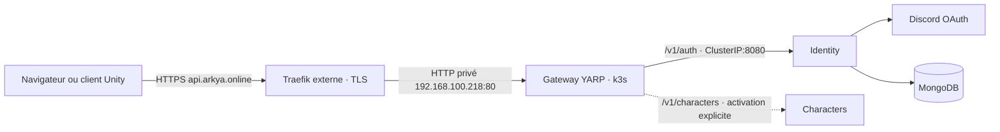

# Gateway YARP sur api.arkya.online

Le point d'entrée public devient **`https://api.arkya.online`**. Le Traefik externe termine TLS et envoie les requêtes à la gateway YARP, qui relaie les routes autorisées vers les services internes. Le navigateur conserve l'URL publique ; ce routage ne lui envoie pas une redirection HTTP vers un sous-service.



La gateway et Identity partagent le namespace existant `arkya-identity`. Identity conserve ses secrets, sa base et son PVC de clés ; la gateway est sans état et sans secret applicatif. Ses deux réplicas utilisent le port 8080 pour les requêtes et le port 8081 uniquement pour les sondes kubelet. Le Service LoadBalancer ne publie que 80 → 8080. Aucun Ingress Kubernetes, certificat ou cert-manager n'est ajouté.

Pour l'étape frontend et Discord, le [profil GitOps dédié](../gitops/frontend-discord/README.md)
déploie les trois composants dans `arkya-beta`, derrière ce seul LoadBalancer.
`Gateway__FrontendEnabled=true`, `Gateway__FrontendHost=arkya.online` et
`Gateway__FrontendAddress=http://arkya-frontend.arkya-beta.svc.cluster.local:8080/`
activent le routage du site. `AllowedHosts` contient `api.arkya.online;arkya.online`.
Les routes API restent séparées du domaine frontend. Ce routage est désactivé
par défaut dans les autres profils.

## Préparer les images et les manifests

Publier les images avec les workflows [Gateway image](GITHUB_ACTIONS.md) et [Identity image](../identity/GITHUB_ACTIONS.md), puis utiliser leurs digests. Identity doit inclure la prise en charge du profil derrière la gateway.

Depuis `backend/deploy/gateway` :

```powershell
New-Item -ItemType Directory -Path .local -Force
Copy-Item cluster.example.json .local/cluster.json
# Renseigner image avec le digest GHCR produit par Gateway image.
./Render-Manifests.ps1 -Configuration .local/cluster.json
```

Le résultat `.local/production/gateway.yaml` contient cinq ressources : Namespace, ConfigMap, Deployment, Service et NetworkPolicy. Le script ne contacte pas l'API du cluster et n'applique rien. Le champ `imagePullSecretName` désigne un Secret de registre existant dans `arkya-identity` si l'image GHCR est privée ; voir le [guide CI](GITHUB_ACTIONS.md).

| Paramètre | Valeur initiale | Usage |
| --- | --- | --- |
| `image` | À renseigner | Digest ou tag SHA de la gateway, jamais `latest` |
| `serviceAddress` | `192.168.100.218` | IP LoadBalancer réservée à la gateway |
| `servicePort` | `80` | Port joint par le Traefik externe |
| `serviceAnnotations` | `{}` | Annotations éventuelles du contrôleur LoadBalancer existant |
| `trustedProxyNetworks` | `192.168.100.0/24` | Sources Traefik acceptées pour les en-têtes et l'accès au pod |
| `charactersAddress` | Vide | Vide : routes Characters désactivées ; renseigné : origine HTTP(S) du service |
| `imagePullSecretName` | Vide | Nom du Secret de lecture du registre, si nécessaire |

`192.168.100.0/24` est une hypothèse explicite sur le réseau privé, pas une IP Traefik observée. Le renderer utilise ces CIDR à la fois pour la confiance dans `X-Forwarded-Proto` et pour la NetworkPolicy. Réduire la plage à la source réelle quand elle sera connue ; ne pas remplacer par `0.0.0.0/0`. La destination `.218` n'est pas la source du Traefik. `externalTrafficPolicy: Local` demande un pod prêt sur le nœud qui reçoit le trafic et conserve la source selon le contrôleur utilisé. Celui-ci doit attribuer `.218` comme pour vos autres Services LoadBalancer ; le manifeste ne crée pas le mécanisme d'allocation.

## Placer Identity derrière la gateway

Utiliser le profil `gateway` d'[Identity](../identity/README.md), avec [cluster.gateway.example.json](../identity/cluster.gateway.example.json). Il produit un Service **ClusterIP au port 8080**, sans Ingress ni adresse LoadBalancer, et n'autorise l'accès applicatif que depuis les pods `arkya-gateway`. Le réseau de confiance d'Identity doit correspondre aux IP des pods gateway ; `10.42.0.0/16` est le défaut k3s proposé, à adapter si le cluster utilise un autre Pod CIDR. Ce réseau diffère du réseau privé de Traefik.

Depuis `backend/deploy/identity`, copier cet exemple dans `.local/cluster.json`, renseigner l'image et la StorageClass, puis exécuter `./Render-Manifests.ps1 -Configuration .local/cluster.json`. Le résultat est `.local/gateway/identity.yaml`.

Ce profil règle notamment :

```text
AllowedHosts=api.arkya.online
Discord__PublicBaseUrl=https://api.arkya.online
Discord__RedirectUri=https://api.arkya.online/v1/auth/discord/callback
```

La destination Identity dans YARP est `http://arkya-identity.arkya-identity.svc.cluster.local:8080/`. Le chemin, la query string OAuth, le Host public, les cookies de corrélation et le jeton Bearer arrivent au service. YARP reconstruit les en-têtes de transfert depuis la requête acceptée de Traefik ; Identity accepte son indication HTTPS uniquement depuis le réseau de confiance configuré. Les liaisons HTTP internes restent sur les réseaux privés maîtrisés.

**Ne pas attribuer `.218` simultanément aux deux Services.** Si l'ancien profil Identity externe est déjà appliqué, préparer une fenêtre de bascule : désactiver son ancien routeur Traefik, appliquer d'abord le profil Identity `gateway`, vérifier que `arkya-identity` est ClusterIP et que l'ancienne allocation `.218` est libérée, puis appliquer la gateway. Si l'ancien profil Ingress avait été utilisé, supprimer explicitement son Ingress obsolète après vérification : un `kubectl apply` de la nouvelle liste ne supprime pas automatiquement les ressources retirées. Ne pas supprimer le namespace ni le PVC Identity.

## Traefik, DNS et Discord

Intégrer [traefik/gateway.dynamic.example.yaml](traefik/gateway.dynamic.example.yaml) au provider fichier du Traefik existant, ou transposer son routeur dans votre configuration habituelle :

- DNS Gandi : `api.arkya.online` pointe vers l'adresse publique de Traefik.
- Routeur : Host `api.arkya.online`, entryPoint HTTPS `websecure` à adapter, destination privée `http://192.168.100.218:80`, Host conservé.
- Certificat : `tls: {}` réutilise un certificat déjà disponible. Pour ACME, préciser `certResolver` avec le nom du resolver déjà configuré dans Traefik.
- Discord Developer Portal : enregistrer exactement **`https://api.arkya.online/v1/auth/discord/callback`** dans les URL de redirection OAuth2 de l'application existante.

Le routeur désactive les journaux d'accès et les traces afin de ne pas enregistrer les codes OAuth présents dans la query string. Si la version Traefik ne propose pas ces options par routeur, appliquer l'équivalent globalement. La gateway est configurée sans journalisation des URL de requêtes. Les secrets Discord restent dans Identity.

## Routes disponibles

YARP relaie une liste de routes et de méthodes explicites. Les routes API conservent leur chemin :

| Route publique | Destination |
| --- | --- |
| `POST /v1/auth/discord/challenges`, `GET /v1/auth/discord/authorize/{id}` | Identity |
| `GET /v1/auth/discord/callback`, `POST /v1/auth/discord/exchange` | Identity |
| `GET /v1/auth/me`, `POST /v1/auth/refresh`, `POST /v1/auth/logout` | Identity |
| `GET /health` | Gateway elle-même |
| `GET/POST /v1/characters`, `GET /v1/characters/{guid}`, `GET /v1/characters/appearance-options` | Characters, seulement si activé |
| `GET /v1/realms`, `POST /v1/characters/{guid}/admissions` | Characters, seulement si activé ; session Arkya requise |
| `GET /v1/content/posts`, `GET /v1/content/posts/{guid}` | Content, seulement si `Gateway:ContentEnabled=true` ; publications anonymes |
| `GET /game/beta-web/{**path}` avec upgrade WebSocket | Dedicated bêta, seulement si activé ; préfixe `/game/beta-web` retiré |

Les prérequêtes `OPTIONS` des appels API sont transmises au service concerné, qui conserve sa politique CORS. Sur le domaine API, `/internal`, les routes d'administration, de développement, Social SDK et les sondes détaillées ne sont pas publiés. Un nouveau sous-service demande une route explicite dans `GatewayRoutes.cs`, sa destination et son filtrage réseau ; aucun chemin générique ne donne accès à toutes ses API.

Le [feed d'actualités et de notes de version](../../../docs/PUBLICATIONS.md) lit
uniquement les snapshots publiés. Le profil GitOps `admin` active son cluster
Content privé, autorise le Host public et l'accès réseau Gateway vers Content.
Les endpoints `/admin/content` et `/internal/content` restent privés ; leurs clés
ne sont jamais transmises au launcher ou au site.

Le tunnel de jeu est désactivé par défaut. `Gateway__RealmGameEnabled=true` et
`Gateway__RealmGameAddress=http://arkya-beta-web-island.arkya-beta-realm.svc.cluster.local:17943/`
activent `wss://api.arkya.online/game/beta-web/` sur ce seul domaine API.
L'adresse interne doit être une origine HTTP Kubernetes complète, sans chemin,
identifiants, query string ou fragment. Traefik termine TLS ; YARP relaie ensuite
l'upgrade et les paquets binaires vers le Service dédié privé. Le chemin reçu
par Unity est `/`. La route n'expose aucune API interne Characters ou Realms.

### Backoffice sur un domaine distinct

Le routage du backoffice est désactivé par défaut. Renseigner `adminAddress` avec l'origine interne d'Admin, par exemple `http://arkya-admin.arkya-operations.svc.cluster.local:8080/`, et `adminHost` avec `backoffice.arkya.online`. Le renderer active alors `Gateway:AdminEnabled`, configure `AdminHost`/`AdminAddress` et ajoute le domaine dans `AllowedHosts`. Le Host exact du backoffice reçoit ses pages, fichiers statiques et `/health` ; il ne reçoit pas les routes Identity/Characters. Les autres Hosts ne sont jamais dirigés vers Admin.

Ajouter le routeur [Traefik backoffice](traefik/backoffice.dynamic.example.yaml) au provider fichier existant, en adaptant domaine, certificat et entryPoint. Il réutilise le service `arkya-gateway` déjà déclaré. Admin exige la confiance explicite dans les proxies pour HTTP privé et conserve ses contrôles de session et antiforgery. Son backend Realms reste interne, en HTTPS. Le [guide opérations k3s](../realms/README.md) décrit ses manifests, Secrets et certificats.

Le test `./Test-AdminRendering.ps1` vérifie cette configuration sans contacter de cluster.

### Catalogue public et domaines de realm

`Gateway:PublicRealmsEnabled=true` et `Gateway:PublicRealmsAddress` ajoutent
uniquement les lectures anonymes `/v1/public/realms` et
`/v1/public/realms/{id}`. Elles sont disponibles sur le domaine API et sur le
frontend principal. Leur destination reste privée ; les cookies, Bearer et
clés interservices sont retirés et le Host est celui du service Realms.
Le profil GitOps `admin` active ce catalogue et son accès réseau privé.

`Gateway:RealmSitesEnabled=true` et `Gateway:RealmBaseDomain=arkya.online`
ajoutent `{id}.arkya.online` au frontend et `{id}.admin.arkya.online` à Admin.
Cette option exige les deux applications et le catalogue public activés.
`AllowedHosts` conserve les hôtes exacts et ajoute seulement les deux motifs
`*.arkya.online;*.admin.arkya.online`. Gateway valide ensuite la forme et les
labels réservés avant tout proxy. Le domaine API ne retombe jamais sur le
frontend. Les routes anonymes sont aussi disponibles sur les domaines publics
des realms ; le détail d'un autre realm y est refusé.

Le [profil GitOps admin](../gitops/admin/README.md) active directement cette
configuration Gateway/Admin, sans changer le chemin de l'Application Argo
existante. Le [guide des sites de realm](../../../docs/REALM_SITES.md) décrit
les entrées DNS `*.arkya.online` et `*.admin.arkya.online`, les certificats
couvrant les deux suffixes et l'exemple Traefik. Un routeur existant couvrant
les sous-domaines à un niveau accepte déjà les realms publics ; il doit aussi
couvrir les sous-domaines Admin imbriqués vers le même YARP privé.

### Activer Characters ultérieurement

Characters existe dans le code mais ce dossier ne le déploie pas. Après avoir déployé son Service interne, renseigner par exemple `charactersAddress` avec `http://arkya-characters.arkya-identity.svc.cluster.local:8080/` **si ce nom et ce port correspondent au Service créé**, puis régénérer. Le renderer active alors `Gateway__CharactersEnabled=true` et sa destination YARP ; sans adresse, ces routes n'existent pas.

Pour HTTP privé, configurer Characters avec les CIDR réels des pods gateway dans `ProxyTrust__KnownNetworks`, autoriser le Host `api.arkya.online` et limiter son ingress réseau aux pods gateway. Sinon, utiliser une destination HTTPS avec un certificat valide ; la gateway ne désactive pas la validation des certificats. Le service doit également pouvoir introspecter les sessions auprès d'Identity via son transport interne authentifié. Le profil Identity initial n'autorise que la gateway : prévoir les accès réseau internes et TLS nécessaires à Characters avant de l'activer, sans rendre `/internal` public. Pour le client web, Characters et Identity disposent de la politique `WebClient:AllowedOrigins` : renseigner l'origine HTTPS exacte du site dans les deux services. Characters doit aussi joindre le catalogue interne Realms ; les clés interservices et dedicated restent privées. Voir le [guide bêta web](../../../docs/WEB_BETA.md).

## Appliquer et vérifier

Après préparation du profil Identity, de ses secrets et des éventuels Secrets de registre, exécuter depuis `backend/deploy/gateway`. Si un ancien routeur Identity est actif, suivre d'abord la fenêtre de bascule décrite plus haut :

```powershell
$arkyaContext = 'CONTEXTE_KUBERNETES'
kubectl --context $arkyaContext apply --dry-run=server -f ../identity/.local/gateway/identity.yaml
kubectl --context $arkyaContext apply -f ../identity/.local/gateway/identity.yaml
kubectl --context $arkyaContext -n arkya-identity rollout status deployment/arkya-identity --timeout=300s
kubectl --context $arkyaContext -n arkya-identity get service arkya-identity -o wide
# Continuer seulement lorsque Identity est ClusterIP et que .218 est libérée.
kubectl --context $arkyaContext apply --dry-run=server -f .local/production/gateway.yaml
kubectl --context $arkyaContext apply -f .local/production/gateway.yaml
kubectl --context $arkyaContext -n arkya-identity rollout status deployment/arkya-gateway --timeout=300s
kubectl --context $arkyaContext -n arkya-identity get services arkya-gateway arkya-identity -o wide
```

La gateway seule doit porter l'adresse externe `.218`. Après activation du routeur HTTPS et enregistrement du callback Discord, exécuter depuis `backend/deploy/gateway` :

```powershell
../identity/Test-Deployment.ps1 -Origin https://api.arkya.online -PrepareWebsiteConfig
```

Ce contrôle vérifie le CORS, les routes privées et le début du parcours de connexion ; après réussite, il prépare `backend/deploy/identity/.local/auth-config.js` avec cette origine publique. Publier ensuite cette configuration sur le site et effectuer une vraie connexion Discord.

`/health` et la readiness gateway indiquent l'état du routeur, pas la disponibilité MongoDB ni celle de chaque sous-service. Identity conserve sa propre readiness MongoDB. Contrôler aussi son rollout et le parcours de challenge ; un routeur sain peut retourner une erreur si un sous-service est indisponible.

Les manifests sont préparés localement. Leur application, le DNS, le certificat, la mise à jour du portail Discord et une connexion réelle restent à réaliser sur votre infrastructure.

## Validation locale

Le runtime YARP passe **43 tests**, avec de vrais serveurs HTTP de destination : routage Identity/Characters, corps et jetons, cookies et redirections OAuth, CORS relayé, en-têtes usurpés, confidentialité des logs, isolation des sondes et panne d’un sous-service. Après extraction de la confiance proxy partagée, Identity conserve 144 tests réussis et Characters en passe 108 ; sept tests MongoDB sont ignorés localement faute de base de test. La publication .NET Release réussit pour `linux-x64` et `linux-arm64`, et les deux workflows passent `actionlint`. Le build complet des images Docker et leur push restent à confirmer par les premières exécutions GitHub.

Les profils sans Characters, avec destination HTTPS Characters et après désactivation ont été rendus hors cluster. Leurs cinq ressources respectives passent les schémas Kubernetes 1.36.1 stricts ; quinze configurations invalides sont refusées, dont les réseaux universels, les ports incorrects et les destinations avec identifiants ou préfixe. Le routage Traefik, les ports exposés, la correspondance entre confiance et NetworkPolicy et les sondes séparées ont été contrôlés dans `output/gateway-manifest-validation`. Cela ne remplace pas la validation serveur du cluster ni le contrôle du parcours public après déploiement.

Le nouveau profil Identity `gateway` produit six ressources valides en mode strict, avec Service ClusterIP 8080 et configuration publique `api.arkya.online`. L’ancien profil LoadBalancer externe conserve ses six ressources valides. Les rendus de contrôle sont dans `output/gateway-integration-validation`.

Références : [Services Kubernetes](https://kubernetes.io/docs/concepts/services-networking/service/), [NetworkPolicies](https://kubernetes.io/docs/concepts/services-networking/network-policies/), [routeurs Traefik](https://doc.traefik.io/traefik/reference/routing-configuration/http/routing/router/).
