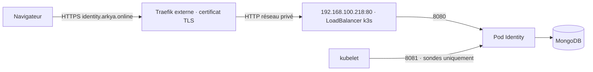

# Traefik externe → Identity sur k3s

**Ce profil direct est remplacé, pour la topologie demandée, par [Traefik → YARP → Identity](../gateway/README.md) sur `api.arkya.online`.** La gateway reprend `192.168.100.218:80` et Identity devient interne via `cluster.gateway.example.json`. Ne pas appliquer simultanément ces deux profils LoadBalancer sur la même IP.

Configuration confirmée : le certificat de `identity.arkya.online` est géré par le Traefik placé devant k3s ; sa destination privée est **`http://192.168.100.218:80`**. Le Service reprend le format déjà utilisé sur ce cluster : `type: LoadBalancer` et `loadBalancerIP: 192.168.100.218`.



Ce profil produit **six ressources Kubernetes** : Namespace, ConfigMap, Deployment, Service, NetworkPolicy et PVC. Il ne crée ni Ingress Kubernetes, ni certificat, ni cert-manager. Les secrets applicatifs et l’image restent ceux du [guide principal](README.md).

## Générer les manifests

Depuis `backend/deploy/identity` :

```powershell
New-Item -ItemType Directory -Path .local -Force
Copy-Item cluster.external-traefik.example.json .local/cluster.json
# Renseigner l’image et la StorageClass dans ce fichier.
./Render-Manifests.ps1 -Configuration .local/cluster.json
```

Le résultat est `.local/external-traefik/identity.yaml`. Le Service expose le port 80 vers le port applicatif 8080 ; le port 8081 n’est jamais exposé. `externalTrafficPolicy: Local` conserve la source réseau lorsque le contrôleur le permet. Le champ `loadBalancerIP` suit votre exemple existant ; c’est le contrôleur LoadBalancer déjà installé qui doit effectivement attribuer cette adresse, pas le manifeste seul. Vérifier que `192.168.100.218` est libre ou déjà réservée à Identity et qu’elle appartient à sa plage d’adresses.

`trustedProxyNetworks` est prérempli à **`192.168.100.0/24`** comme hypothèse de réseau privé, faute d’IP source Traefik précisée. Ce paramètre alimente à la fois la confiance ASP.NET dans les en-têtes transférés et l’autorisation réseau vers le pod. Toute cette plage est donc considérée de confiance : ajuster la plage si le réseau réel ou la source après NAT diffère, ou la réduire à `/32` lorsque l’adresse sera connue. La destination `192.168.100.218` n’est pas l’adresse source du proxy. Aucun accès global `0.0.0.0/0` n’est nécessaire.

Avec le ServiceLB natif de k3s, l’adresse publiée provient d’un nœud ; il n’alloue pas une VIP arbitraire. De plus, la politique `Local` demande un endpoint Identity prêt sur le nœud qui reçoit le trafic. Si votre contrôleur habituel gère déjà des VIP comme dans l’exemple fourni, conserver ce mécanisme. Ce profil ne modifie ni le contrôleur, ni les routes réseau, ni le placement des autres applications.

## Configuration du Traefik existant

[traefik/identity.dynamic.example.yaml](traefik/identity.dynamic.example.yaml) contient une configuration dynamique Traefik v3 à intégrer au provider fichier existant, ou à transposer dans son gestionnaire actuel. Elle conserve le Host `identity.arkya.online` et pointe vers `http://192.168.100.218:80`.

- Adapter `websecure` si l’entryPoint HTTPS porte un autre nom.
- `tls: {}` utilise un certificat déjà disponible dans Traefik. Si Traefik doit en demander un automatiquement, renseigner `tls.certResolver` avec le nom de son resolver existant. Aucun resolver ACME n’est créé par cet exemple.
- Le DNS Gandi de `identity.arkya.online` pointe vers **l’adresse publique de Traefik** ; `192.168.100.218` reste la destination privée.
- Les routes publiques sont limitées à la connexion et `/health`, sans restriction qui bloquerait les prérequêtes `OPTIONS`. Aucun routeur générique ne doit ensuite exposer les chemins `/internal`, Social SDK ou les sondes détaillées vers Identity.
- Les journaux d’accès et traces de ce routeur sont désactivés pour ne pas enregistrer les codes du callback OAuth. Sur une version Traefik ne supportant pas ce réglage par routeur, appliquer l’équivalent dans sa configuration globale.

Traefik transmet `X-Forwarded-Proto: https` lors de la requête HTTPS entrante. Identity n’accepte cette indication que depuis le réseau déclaré. La liaison Traefik → k3s utilise HTTP sur le réseau privé indiqué ; elle doit rester sur ce réseau de confiance. Ne pas forcer artificiellement `X-Forwarded-Proto` sur un accès public HTTP ni activer la confiance universelle aux en-têtes sur Traefik.

## Déployer et vérifier

Publier l’image avec [GitHub Actions → GHCR](GITHUB_ACTIONS.md), reporter le digest dans `.local/cluster.json` et régénérer les manifests. Créer les secrets applicatifs et, si l’image est privée, le Secret d’accès au registre comme dans le [guide principal](README.md). Puis :

```powershell
$identityContext = 'CONTEXTE_KUBERNETES'
kubectl --context $identityContext apply --dry-run=server -f .local/external-traefik/identity.yaml
kubectl --context $identityContext apply -f .local/external-traefik/identity.yaml
kubectl --context $identityContext -n arkya-identity rollout status deployment/arkya-identity --timeout=300s
kubectl --context $identityContext -n arkya-identity get service arkya-identity -o wide
```

L’adresse affichée doit bien être `192.168.100.218` et le port 80. Après mise en place du routeur et du certificat Traefik :

```powershell
./Test-Deployment.ps1 -PrepareWebsiteConfig
```

Le callback Discord reste `https://identity.arkya.online/v1/auth/discord/callback`. Le script contrôle le parcours public, crée un challenge temporaire et prépare la configuration du site après réussite. Il reste ensuite à actualiser la politique de confidentialité, publier la configuration web et vérifier une vraie connexion Discord, comme décrit dans le guide principal.

## Vérification

Le profil a été rendu hors cluster : six ressources valides selon les schémas Kubernetes 1.36.1 en mode strict, avec l’IP `192.168.100.218`, le port 80 et aucune ressource Ingress/TLS. Le profil Ingress précédent produit toujours ses sept ressources. Les contrôles de configuration refusent notamment les réseaux universels, les adresses de service invalides et les ports incorrects. La syntaxe YAML Traefik, la destination, le Host et la liste des routes sont vérifiés ; le Traefik réel n’a pas été reconfiguré. Résultats : `output/identity-external-traefik-validation/schema-results.json` et scénario `output/identity-traefik-qa.py`, à la racine du dépôt.

Les champs image, StorageClass et secrets restent à renseigner pour votre installation. Aucun déploiement, DNS ou connexion OAuth réelle n’a été effectué par cette adaptation.

Références : [Service Kubernetes](https://kubernetes.io/docs/concepts/services-networking/service/), [ServiceLB k3s](https://docs.k3s.io/networking/networking-services#service-load-balancer), [routeurs Traefik](https://doc.traefik.io/traefik/reference/routing-configuration/http/routing/router/), [services Traefik](https://doc.traefik.io/traefik/reference/routing-configuration/http/load-balancing/service/).
