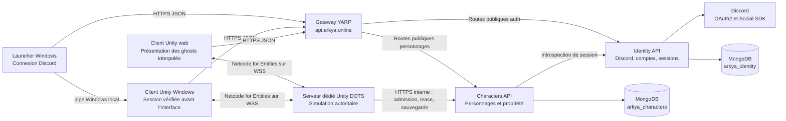

# Architecture Arkya

Les [sites dédiés aux realms](REALM_SITES.md) ajoutent une liste publique sur
le site principal, une page `https://{realmId}.arkya.online/` et un espace
opérateur `https://{realmId}.admin.arkya.online/`. Ils partagent les services
existants : Realms expose un DTO anonyme limité, actualisé périodiquement,
et Admin conserve les sessions et les mutations. La connexion Discord reste
centrale et les cookies partagés sont limités au domaine `admin.arkya.online`.
Le profil GitOps `admin` active directement le routage wildcard et l'espace
Admin dédié, sans changer le chemin de l'Application Argo existante.
Les entrées DNS et les certificats TLS sont configurés sur l'entrée publique.

Les [sessions renouvelables](AUTH_SESSIONS.md) conservent la séparation joueur/admin :
Identity possède les familles de refresh des joueurs ; Admin possède désormais
ses sessions dans `arkya_admin`, avec allowlist revérifiée, rotation et révocation.
Le [launcher Windows](WINDOWS_LAUNCHER.md) distribue des builds Unity complets
via manifeste HTTPS, archive vérifiée et installation dans le profil utilisateur.
Il effectue aussi la connexion Discord et remet en mémoire la session Arkya au
jeu Windows ; Unity la revalide avant d’afficher la sélection ou la création.

La [console d'administration](ADMIN_CONSOLE.md) consulte les comptes via
Identity et les personnages/leases via Characters. Identity conserve bans,
droits bêta et audit ; Characters applique le contrôle bêta à l'admission et
aux renouvellements. Admin lit ces données métier via les API privées ; sa propre base MongoDB conserve uniquement ses sessions.
La fiche personnage projette également les statistiques du snapshot autoritaire
et les quêtes persistées, sans exposer le JSON de simulation brut. Les sacs,
la banque et l'équipement sont sauvegardés atomiquement avec l'état du personnage
et affichés dans la fiche ; voir la [persistance des possessions](CHARACTER_POSSESSIONS.md).

Arkya utilise Unity DOTS (Data-Oriented Technology Stack) pour la simulation temps réel et Netcode for Entities pour le multijoueur sous autorité serveur. La simulation, exécutée par un serveur dédié Unity, est séparée des services ASP.NET Core qui possèdent les comptes et les données persistantes. La décision sur ces services est détaillée dans [0002 — Services backend](decisions/0002-backend-services.md).

## Vue d'ensemble

La cible réseau et services est détaillée dans [Backoffice et déploiement des realms](REALM_DEPLOYMENT.md) : Traefik VM → YARP public → frontend/backoffice/API, avec des endpoints de jeu distincts. La [bêta web](WEB_BETA.md) ajoute WSS vers un dedicated Unity TCP derrière terminaison TLS, l’admission Characters et les leases de personnages. Les profils UDP et le prototype de partitions restent séparés. Les fichiers de déploiement nécessitent encore leur configuration et leur validation sur l’environnement réel.

Identity et Characters possèdent les comptes, sessions et personnages persistants. La [scène Unity de création](CHARACTER_CREATION.md) branche leur création, liste et apparence sur ces services. Le joueur Windows reçoit sa session du launcher ; le web la reçoit du site après connexion Discord. Après revalidation, le client choisit une destination Realms et demande une admission à usage unique avant d’entrer sur l’île dédiée. Un [prototype Unity isolé](AREA_PROTOTYPE.md) conserve deux processus serveurs et deux clients sur une carte continue, avec transferts d’autorité et combat interzone ; son intégration avec cette admission reste à réaliser. Le bootstrap historique conserve son parcours décrit dans [Enter World](ENTER_WORLD_FLOW.md).

L’entrée publique préparée est maintenant **`api.arkya.online`**, avec [une gateway YARP](../backend/deploy/gateway/README.md). Le Traefik externe termine TLS et joint le LoadBalancer de la gateway à `192.168.100.218:80`. YARP transmet les chemins publics existants aux services sans ajouter de préfixe et sans rediriger le navigateur vers une adresse interne. Identity passe en ClusterIP via son profil `gateway`, avec un callback Discord sur `https://api.arkya.online/v1/auth/discord/callback`. Les anciens profils directs `identity.arkya.online` restent disponibles pour une installation sans gateway ; ils ne doivent pas occuper la même IP simultanément.

La confiance dans les en-têtes HTTPS est contrôlée séparément à chaque saut : réseau source Traefik dans la gateway, réseau des pods gateway dans Identity/Characters. YARP remplace les en-têtes transférés à partir du contexte normalisé. Les liaisons HTTP Traefik→gateway et gateway→Identity sont limitées aux réseaux privés autorisés ; les API internes interservices conservent leurs exigences TLS et clés de service. Les NetworkPolicies limitent l’entrée dans Identity aux pods gateway. Le port de gestion séparé expose les sondes kubelet : la readiness Identity teste MongoDB, celle de la gateway teste seulement son propre processus. Identity conserve son réplica et son volume de clés Data Protection. Le routage Characters s’active lorsque sa destination et ses dépendances sont déployées ; aucun déploiement Characters n’est inventé par ces manifests. Ces fichiers restent à appliquer au cluster.

Le [profil initial frontend et Discord](../backend/deploy/gitops/frontend-discord/README.md)
utilise un seul LoadBalancer privé `192.168.100.218:80` devant YARP :
`arkya.online` rejoint le frontend en ClusterIP et `api.arkya.online`
rejoint les routes publiques d'Identity, également en ClusterIP.
TLS est terminé par Traefik, qui reste géré séparément ; ce profil utilise
HTTP privé vers YARP et Identity, sans listener TLS ni certificat dans les pods.
Le profil hérite
des images de la bêta, mais ne rend que ces trois services ; les routes Admin
et Characters sont désactivées. L'Application Argo `arkya-services` pointe
directement vers ce profil, avec destination `arkya-beta` et une seule
source. La bêta complète conserve son profil distinct,
avec ingress site et deuxième source Unity.

## Client et serveur dédié Unity

La [conception du combat et des classes](GAMEPLAY_CLASSES.md) prévoit Warrior, Scout, Mage, Cleric et Druid, une classe active à la fois, des sorts hérités des autres classes et un rating de niveau global. Elle distingue les règles confirmées des choix encore ouverts ; ce système de progression n'est pas encore implémenté.

Les [familiers totems](GAMEPLAY_TOTEMS.md) ajoutent une direction confirmée : chaque joueur se lie dès le départ à une âme animale, avec le loup et le renard comme premières espèces. Les assets riggés et leurs pelages relèvent de la présentation. Le choix persistant, l'apparition et les règles de gameplay restent à intégrer sous autorité serveur.

Le client possède les entrées, le rendu, l'interface, l'audio, les animations, le chargement des assets et la prédiction locale. Le serveur dédié possède la vérité pour le mouvement, les combats, les interactions, les apparitions, l'inventaire, l'économie et la progression. Les entités distantes sont interpolées, sauf besoin explicite de prédiction.

La simulation s'appuie sur Unity DOTS : Entities (ECS), le C# Job System et Burst. Netcode for Entities assure la réplication réseau, la prédiction locale et la réconciliation sous autorité serveur. Les composants de données restent compacts, les systèmes sont séparés par monde client/serveur, les changements structurels passent par des Entity Command Buffers (ECB) et la présentation observe la simulation. Les MonoBehaviours restent adaptés à l'authoring, au bootstrap, aux caméras et à l'UI.

La [première base d'inventaire et de récolte](GAMEPLAY_FOUNDATION.md), dans `Unity3D/Arkya/Assets/Arkya/Gameplay/`, fournit des statistiques, jusqu'à 150 emplacements, le portage, les nœuds de ressources et les effets d'outils/pierres. `HarvestSystem` applique les demandes uniquement en monde serveur ; son authoring doit être placé dans une SubScene. Cette base reste indépendante de l'île et du prototype : aucune UI, RPC, association de connexion, migration d'area ou persistance n'est encore branchée. `CharacterStats.Health` concerne ces entités indépendantes ; le combat du prototype conserve son unique état de vie dans `PrototypeActor.Health`. Leur future intégration devra unifier cette propriété, sans ajouter une seconde source de vérité sur un même acteur.

Le serveur dédié demande les données initiales et transmet les mutations persistantes à leurs services propriétaires. Le client ne fournit jamais un résultat de combat, un solde ou un inventaire faisant autorité. La première persistance de progression concerne les quêtes de type « tuer N ennemis » : sauvegardes regroupées, concurrence optimiste et retries idempotents. Les sacs, la banque et l'équipement de l'acteur admis utilisent désormais le même bail et la même révision que sa sauvegarde de monde ; les systèmes de gain et les interactions d'objets restent à raccorder.

### Création, apparence et entrée sur l’île

La [première tranche de statistiques et compétences](CHARACTER_STATS_SKILLS.md)
ajoute à l’acteur d’exploration un état ECS autoritaire, répliqué au propriétaire :
vie/mana/endurance, classe active, niveaux/XP et rangs appris. La fiche `C` et les
jauges lisent ce ghost. Les sauvegardes et handoffs conservent cet état dans le
JSON de simulation versionné ; les effets de combat et les sources de récompenses
restent à intégrer. Ce schéma utilise la paire `2 / arkya-character-stats-v1`.

La scène `Assets/Arkya/Characters/Scenes/CharacterCreation.unity`, dans `Unity3D/Arkya/`, réunit l'interface UI Toolkit, le client HTTPS Identity/Characters et la présentation Valkyrie. Depuis le 22 octobre 2026, le catalogue visuel partage cette base entre les quatre couples historiques race/silhouette sans modifier leurs identifiants persistants ou réseau ; la nouvelle création propose uniquement le modèle humain féminin et sa coiffure longue disponibles. Le rig Generic, les matériaux peints, la taille visuelle et les animations Idle/Walk/Run/Jump/SwimIdle/Swim appartiennent à la présentation. Ils ne possèdent aucune statistique autoritaire. Le choix de taille applique une échelle visuelle et ne change pas les collisions ou la vitesse.

Cette migration visuelle conserve le contrat d’apparence version 1 et les
valeurs déjà sauvegardées : les capacités de création du catalogue sont
distinctes des identifiants acceptés par Characters et répliqués par Netcode.
Le bouton **Nouveau** choisit `human/b/long` sans convertir un personnage
existant. Le [bilan ciblé du 22 octobre](CHARACTER_CREATION.md#intégration-valkyrie--22-octobre-2026)
compte 65 réussites sur 66 tests, sans échec ; le test avec services réels est
ignoré faute de `ARKYA_WEB_BETA_TICKETS_FILE`.

Dans le parcours Windows distribué, `LauncherIdentityClient` ouvre la connexion Discord dans le navigateur système auprès de l’origine Identity fixe `https://api.arkya.online`. La session Arkya reste en mémoire et `/v1/auth/me` est vérifié après la connexion puis avant le démarrage du jeu. `LauncherSessionHandoff` remet la session une seule fois sur un pipe Windows local et aléatoire, limité à l’utilisateur courant et au PID du jeu lancé. Le message et ses délais sont bornés ; seul le nom du pipe passe dans l’environnement, puis Unity l’efface. Le bearer ne passe ni par un fichier ni par les arguments du processus. L’usage unique porte sur la remise locale, pas sur la session HTTPS elle-même.

`CharacterNativeSessionBridge` et `CharacterServiceClient.ImportLauncherSessionAsync` revalident `/v1/auth/me` sur les origines intégrées au build. Le compte doit correspondre et l’expiration retenue ne peut dépasser celle de la remise. La sélection et la création restent masquées jusqu’à cette validation ; une session absente, invalide ou expirée laisse ces vues masquées ou les masque de nouveau et invite à quitter le jeu puis à se reconnecter dans le launcher. Une révocation distante est détectée lors des appels authentifiés. L’Editor conserve la connexion directe de `CharacterServiceClient` et l’aperçu sans compte ; le WebGL conserve la session du site. La connexion OAuth Discord réelle et le parcours complet launcher/jeu Windows construit/dédié restent à valider pour cette révision.

Les origines de l’asset de scène restent locales pour le développement. Le
workflow Windows fournit les trois origines Identity, Characters et Reports
`https://api.arkya.online` à `CiBuild.ClientEndpointOverride`, qui les intègre au
build puis restaure l’asset source. Le pipe ne transporte aucune URL ; la remise
de session ne remplace pas cette configuration pendant l’exécution.

L’activation sociale ajoute un jeton d’accès Discord et un ticket de renouvellement en mémoire, via une autorisation distincte. Le client n’embarque ni secret Discord, ni clé de service, ni accès MongoDB. La création transmet un contrat d’apparence versionné ; Characters le valide et choisit le propriétaire à partir de la session.

L’essai local, réservé à l’Editor sans compte, crée ses propres mondes serveur/client Netcode sur loopback, port 17843. Le client envoie des intentions de déplacement par RPC ; le serveur vérifie la connexion, les séquences, les valeurs et les bornes avant de simuler le mouvement. La présentation lit un ghost interpolé pour placer et animer le modèle. Ces mondes sont détruits au retour à la création et restent séparés du prototype d’areas. Cet essai ne constitue pas une admission d’un personnage MongoDB dans un realm. Voir le [guide de création](CHARACTER_CREATION.md) pour les assets, la configuration et les limites.

Dans l’Editor, le bouton **Explorer l’île (Editor)** charge `StarterIsland` de façon additive et conserve l’UI et l’apparence de création. Le serveur possède une copie immuable du relief et applique les déplacements, les pentes, les sauts, la gravité, la nage et les obstacles statiques ; le client ne transmet aucune position. Chaque pression de saut porte une séquence consommée une seule fois par le serveur ; la vitesse verticale et la phase de traversée restent locales au serveur. Le champ de mouvement répliqué sélectionne la présentation au sol, en l’air ou dans l’eau. La nage utilise le niveau marin moyen ; les vagues restent visuelles. L’[essai local](world/STARTER_ISLAND_PLAYABLE.md) conserve ses deux mondes loopback, détruits avant de libérer le terrain et de décharger l’île. Le joueur Windows distribué utilise l’admission au dédié, sans repli vers cet essai.

En WebGL, `CharacterWebSessionBridge` reçoit la session du site et Unity la revalide ; aucun essai loopback n’est autorisé. Après sélection du realm/personnage, Characters délivre un ticket court. `CharacterNetworkWorlds` crée uniquement un client WebSocket ; `CharacterServerAdmissionSystem` consomme ce ticket via HTTPS avant `ConnectionApproved` et le spawn du ghost. L’identité et l’apparence répliquées viennent de la réponse serveur. Chaque ghost porte un propriétaire Netcode, tandis que la présentation interpole tous les acteurs et réserve les entrées/caméra au personnage possédé.

Le dedicated charge une copie de l’île avec colliders préparés avant stripping. Il réutilise la simulation ECS de terrain et les collisions statiques Unity, renouvelle la lease toutes les 20 secondes et sauvegarde position/orientation toutes les 15 secondes ainsi qu’à la fermeture. Les écritures sont conditionnées par lease, époque et révision. Une expiration ou un refus d’autorité arrête l’acteur. Le [guide bêta web](WEB_BETA.md) conserve le parcours historique. Le [runtime de handoff StarterIsland](STARTER_ISLAND_HANDOFF.md) ajoute en version 2 une topologie de partitions et le transfert du snapshot de déplacement avec sa lease. Les [possessions](CHARACTER_POSSESSIONS.md) de l'acteur admis sont maintenant conservées dans ces sauvegardes et transferts ; les quêtes, interactions de récolte et le combat du prototype gameplay restent séparés.

### Realms et domaines de simulation

Un realm est un univers logique persistant choisi par le joueur. Il contient plusieurs **Areas**, chacune représentant une carte entière : l'île de départ `starter-island` est une Area. Chaque Area configure son identifiant, ses dimensions, son origine et son nombre de partitions d'autorité. Une partition est simulée par un processus dedicated Unity, avec une seule réplique Kubernetes. Quatre dedicateds pour l'Area de départ signifient quatre portions de cette même Area. Le realm regroupe les dedicateds de toutes ses Areas et les capacités prévues pour les instances et les raids. La [décision 0003](decisions/0003-realms-and-area-authority.md) fixe ce vocabulaire.

La hiérarchie est `Realm → Areas → partitions → dedicateds`. Deux Areas peuvent avoir les mêmes coordonnées locales ; leur identifiant les distingue. Les champs historiques `topology.islands` et `islandId` désignent respectivement les Areas et leur identifiant dans les contrats et snapshots existants. Le type `Island` et les IDs de processus `island-*` restent compatibles ; cette clarification ne les migre pas.

La topologie est définie à la création du realm et conservée dans un snapshot de profil. Une édition explicite avec révision attendue peut encore changer ce plan et son profil en état `Draft`. Dès qu'un déploiement est engagé, le découpage reste figé ; une migration à chaud demandera un workflow de drain distinct. La liste accepte toutes les Areas à prévoir, sans règle spécifique à StarterIsland. Les dimensions utilisent le plan X/Z Unity : une Area de 1 000 × 1 000 à l'origine (0, 0), répartie sur quatre dedicateds, produit quatre partitions de 500 × 500. Les frontières intérieures appartiennent à une seule partition selon des intervalles semi-ouverts ; le bord extérieur maximal reste inclus. Les indices, le nombre de partitions et leurs bornes décrivent le plan de simulation. Le build doit encore disposer du contenu et du routage correspondants.

Les compteurs dédiés aux instances et raids décrivent des emplacements de processus distincts des partitions d'Area. Leur allocation à une partie ou à un groupe, les droits d'entrée, le retour au monde ouvert et leur cycle de vie restent à implémenter. Ces instances privées conservent le realm du personnage.

Le plan peut être enregistré avec un profil historique, mais son déploiement exige une déclaration figée de compatibilité, des processus d’île et la paire réseau `2 / arkya-partition-handoff-v1` ; sinon il est refusé avec `topology_runtime_unsupported`. Le catalogue publie les bornes et les destinations des plans d’île compatibles. Characters résout la partition de la position persistée et impose la correspondance exacte de la paire client. Les API gardent le parcours `1 / arkya-web-beta-v1` pour les images historiques. Les compteurs d’instances ou de raids restent enregistrables mais empêchent le déploiement avec le runtime v2 actuel. Les autres contenus d’île doivent encore être fournis et intégrés ; la configuration ne charge pas automatiquement une nouvelle scène.

Le combat doit rester continu entre partitions voisines d'une même Area. Le serveur propriétaire d'une entité reste seul autorisé à en modifier l'état. Les propriétaires échangent les observations nécessaires aux cibles proches ; celui de la cible valide et applique un impact une seule fois. Une frontière technique ne crée ni arrêt du combat ni nouvelle scène. Le [runtime multi-Area version 3](MULTI_AREA_RUNTIME.md) ajoute des portails automatiques : un rectangle d'entrée source et un point d'arrivée cible, validés par les services et le dedicated. Des coordonnées identiques ou voisines de cartes distinctes ne déclenchent aucun transfert implicite. Un changement de realm reste une autre opération.

L'Area de l'[île de départ, niveaux 1 à 6](world/STARTER_ISLAND.md), doit aussi pouvoir disposer de plusieurs copies indépendantes par realm. La destination logique cible est `(realmId, areaId, instanceId)` : une instance conserve le realm et l'identité de la carte, tout en isolant sa simulation des autres copies ; chaque copie peut être subdivisée en partitions. Avoir plusieurs Areas dans un realm et avoir plusieurs copies d'une même Area sont deux configurations distinctes. Le runtime sélectionne maintenant les scènes par `contentId` dans un registre inclus dans le build. StarterIsland et une vallée de validation ont des scènes distinctes ; les cartes supplémentaires doivent fournir leur contenu. Les réservations et le placement des groupes entre copies restent à réaliser.

Son [environnement de présentation](world/STARTER_ISLAND_ENVIRONMENT.md) utilise un cycle visuel de quatre heures, basé sur UTC et corrigeable par un futur échantillon serveur. Le ciel, l’éclairage, les sons et les animations décoratives restent locaux. Toute conséquence du cycle sur les quêtes, apparitions ou récompenses devra être décidée par la simulation serveur ; le composant de ciel ne possède aucun état de gameplay autoritaire.

La [météo de l’île](world/STARTER_ISLAND_WEATHER.md) suit également un calendrier cosmétique déterministe UTC, avec une graine configurable et des transitions progressives. Elle module la présentation existante et ajoute pluie et orages décoratifs. Elle n’ajoute ni état de gameplay autoritaire ni réplication ; une future météo qui influence la simulation devra être possédée par le serveur.

Les [vingt PNJ d’Aubefont](TOWN_NPCS.md) utilisent des ghosts interpolés et des comportements ECS possédés par leur partition : poste fixe, promenade locale ou patrouille. Le serveur contrôle la portée et la connexion avant de transmettre un dialogue à l’inférence ; seule une réponse textuelle revient au client. Leur catalogue fournit les identités, profils et liens de quêtes, sans acceptation ni récompense implicite. La paire réseau `5 / arkya-town-npcs-v1` étend le runtime existant ; la visibilité des PNJ entre partitions reste à réaliser.

Le prototype actuel emploie des identifiants de test et deux partitions fixes sur loopback, sans catalogue de realms ni lien avec les personnages MongoDB. Son code historique les nomme `AreaId` ; elles ne correspondent pas à deux Areas du modèle métier actuel. Ses ghosts sont interpolés et chaque client se connecte aux deux serveurs. Son protocole illustre préparation, libération et activation de l'autorité par époque, en conservant l'historique et le registre d'impacts ; il ne fournit pas encore une migration durable ou une gestion d'intérêt adaptée au MMORPG complet.

Le passage du joueur utilise une préparation idempotente, un claim cible sans
lease active, un seal du snapshot final puis un commit atomique dans le document
MongoDB de lease. Le commit remplace le serveur et la lease, puis incrémente
l'époque ; les anciennes écritures sont refusées. Le snapshot conserve la
position, l'orientation, les intentions, les séquences d'entrée/saut et l'état
complet de traversée actuellement présent sur cet acteur. La seconde connexion
cliente est préparée avant la bascule et la présentation suit l'identité
persistante et l'époque. Une annulation et un commit concurrents ne peuvent
pas gagner ensemble. Les [contrats et preuves du handoff](STARTER_ISLAND_HANDOFF.md)
décrivent les timeouts et la reconnexion depuis l'état durable.

Cette tranche concerne le joueur admis sur StarterIsland. La visibilité
frontalière des autres autorités, les PNJ, les effets de combat dédupliqués et
l'allocation de parties privées restent séparés. Un run réel avec quatre
exécutables dedicated et un client Unity Editor rendu a réussi six handoffs,
avec un blocage maximal mesuré de 0,43 seconde près d'une frontière. Le client
natif exporté et le déploiement public restent à valider.

## Services ASP.NET Core

Le [profil de déploiement progressif Admin](../backend/deploy/gitops/admin/README.md)
ajoute Admin, Content et Realms au frontend/Identity/YARP dans `arkya-beta`.
`admin.arkya.online` utilise le même LoadBalancer et le routage YARP.
Le HTTPS public est terminé par Traefik ; Admin appelle Content/Realms
en HTTP privé, avec activation explicite limitée aux noms Kubernetes.
Les API vérifient le pair réseau direct contre une liste de réseaux privés,
en plus de leurs clés d'authentification ; les NetworkPolicies limitent
leurs entrées aux pods Admin, ainsi qu'aux pods Gateway pour le feed public Content. Les exigences HTTPS des autres profils
restent inchangées. Les modules Quêtes et Realms sont disponibles, tandis
que le déployeur Kubernetes et l'admission de jeu restent désactivés
jusqu'à la configuration des dedicateds.

| Projet | Responsabilité | Données possédées |
| --- | --- | --- |
| `Arkya.Gateway` | Reverse proxy YARP, routes publiques explicitement autorisées dont Identity, Characters et publications Content ; backoffice sur un domaine distinct | Aucune donnée métier |
| `Arkya.Identity.Api` | Connexion Discord, identité Arkya, création, validation et révocation des sessions | Comptes, challenges de connexion, sessions dans `arkya_identity` |
| `Arkya.Characters.Api` | Personnages du compte, validation d’apparence, liaison au realm, admission, leases et sauvegarde autoritaire de position | Personnages, admissions et état persistant dans `arkya_characters` |
| `Arkya.Content.Api` | Brouillons de quêtes, catalogues immuables, actualités et notes de version publiables | Catalogues et `content_posts` dans `arkya_content` |
| `Arkya.Reports.Api` | Bugs (F8) et suggestions (F9) avec capture, type immuable, suivi, tags et révisions de triage | Rapports et PNG bornés dans `arkya_reports` |
| `Arkya.Admin` | Interface web authentifiée pour le contenu, les realms et les signalements ; MCP signalements/publications facultatif | Sessions d’administration dans `arkya_admin` ; données métier via les autres services |
| `Arkya.Realms.Api` | Catalogue opérateur des realms, demandes de déploiement durables et observation des dedicated k3s | Définitions, profils figés et état des opérations dans `arkya_realms` |
| `Arkya.Backend.Api` | Ancien parcours local : annuaire de serveurs mock et connexion de développement | Sessions de développement en mémoire |
| `Arkya.ServiceDefaults` | Bibliothèque technique commune : options MongoDB et authentification des appels de service | Aucune donnée métier |

Les [signalements](BUG_REPORTS.md) utilisent l'introspection Identity pour
attribuer le propriétaire, une insertion MongoDB atomique rapport/capture,
un UUID de retry par compte et des mises à jour administrateur conditionnées
par révision. Admin expose une interface de triage et, sur activation explicite,
un MCP HTTP `/mcp/reports` authentifié par un bearer distinct de ses clés Reports
et Content. Quand Content est activé, ce même bearer autorise aussi les mutations
des actualités et notes de version. Les outils partagés de `Arkya.Reports.Mcp`
et `Arkya.Publications.Mcp` servent aussi l'hôte stdio `Arkya.Admin.Mcp` ; celui-ci
active les publications uniquement avec `Publications:Enabled=true`.
Aucun de ces outils n'exécute de code ni ne déploie de build :
Codex utilise les preuves pour travailler dans le dépôt, puis consigne la validation.
Le [profil Reports](../backend/deploy/gitops/reports/README.md) étend Admin
sans modifier les profils antérieurs ; ses secrets et son image sont provisionnés
avant activation. Son exception HTTP privée Identity concerne uniquement
`/internal/sessions`, vérifiée sur le pair réseau direct.

`Arkya.Realms.Api` fournit le catalogue opérateur et le déploiement de processus dédiés dans des namespaces k3s préautorisés. Son catalogue interne de destinations est désormais exposé aux joueurs authentifiés par Characters. Characters lie atomiquement le personnage à un `realmId` et délivre un ticket seulement pour une destination compatible et activée. Les noms de personnages restent globalement uniques ; l’identité du compte et l’appartenance au realm sont vérifiées côté services.

Les nouvelles API ciblent .NET 10. Chaque service sépare contrats HTTP, règles applicatives et adaptateurs de persistance. Les documents MongoDB restent internes. Un `accountId` Arkya est stable et distinct de l'identifiant Discord ; Characters conserve cette référence sans lire la base Identity.

Les [bugs et suggestions](BUG_REPORTS.md) utilisent la session Identity du joueur.
Admin présente les captures et le suivi, et expose le MCP facultatif `/mcp/reports`
avec une clé distincte des clés de service. Les outils MCP filtrent par type,
tag et statut et appliquent les mises à jour avec contrôle de révision.
Le [composant Reports](../backend/deploy/gitops/reports-control/README.md)
s'intègre au profil Admin et à la promotion CI des images.

La gateway conserve l’authentification et les règles métier dans les services. Son allowlist de routes API est explicite : elle inclut la connexion Identity, les endpoints joueurs activés et les lectures de publications Content. `Gateway:ContentEnabled` expose seulement `GET /v1/content/posts` et `GET /v1/content/posts/{id}`, avec `OPTIONS`. Un routage Admin facultatif dessert exclusivement son domaine configuré, distinct de `api.arkya.online` ; la gestion Content, les catalogues de quêtes du dedicated et les API Realms restent internes. Les routes Social SDK restent hors de cette exposition web. Les futures routes doivent être ajoutées volontairement et testées. Le workflow `Services images` vérifie les services, publie leurs images et promeut ensemble les dix digests dans GitOps.

Un même processus MongoDB peut héberger les deux bases en développement. Chaque service reste seul propriétaire de sa base : pas de jointure entre bases ni de lecture directe des collections d'un autre service. En déploiement, fournir des comptes MongoDB limités à leur base ; les identifiants administrateur du Compose servent uniquement au développement local.

### Identity et Discord

Identity possède aussi les [inscriptions à la bêta](BETA_REGISTRATION.md) :
date de candidature par compte Discord, consultation du statut et attributions
administrateur conditionnées à l'éligibilité et à la révision. Les tirages
aléatoires possèdent une opération durable pour empêcher un retry de distribuer
des accès supplémentaires. Le site ne peut pas s'attribuer un droit ; Characters
continue d'appliquer l'entitlement autoritaire existant.

Le fournisseur initial est Discord, avec le flux OAuth2 Authorization Code et le seul scope `identify` pour la connexion du compte Arkya. Le secret de l'application Discord et l'échange du code restent dans Identity. Ce parcours de connexion ne transmet aucun jeton Discord au client Unity. Ce fonctionnement suit les mécanismes documentés par [Discord OAuth2](https://docs.discord.com/developers/topics/oauth2).

Le protocole Arkya relie le launcher Windows au navigateur ; le client Unity dans l’Editor conserve ce flux pour le développement :

1. Le launcher, ou le client dans l’Editor, génère un `codeVerifier` aléatoire, conservé en mémoire, et envoie son empreinte S256 à `POST /v1/auth/discord/challenges`.
2. Identity renvoie une URL d'autorisation sous son propre domaine et un challenge valable cinq minutes.
3. Le navigateur ouvre cette URL. Identity crée un état OAuth à usage unique et un cookie de corrélation `Secure`, `HttpOnly`, `SameSite=Lax`, puis redirige vers Discord.
4. Discord revient sur le callback HTTPS fixe d'Identity. Identity vérifie l'état et le cookie, échange le code et associe le compte Arkya au compte Discord.
5. Le launcher, ou le client dans l’Editor, interroge `POST /v1/auth/discord/exchange` avec le challenge et son vérificateur. La réponse est en attente (`202`) ou fournit une session Arkya, une seule fois (`200`). Le launcher ne demande pas de cookie de renouvellement et vérifie ensuite `/v1/auth/me`.

La preuve S256 appartient au protocole de remise Arkya ; elle ne présume pas d'un support PKCE chez Discord. Une session Arkya est un jeton opaque aléatoire dont seule l'empreinte est persistée. Sa durée par défaut est de huit heures. Expiration et révocation sont vérifiées lors des lectures, indépendamment du nettoyage différé par index TTL MongoDB.

Le site effectue la connexion dans le même onglet. Il conserve temporairement le challenge et son vérificateur dans `sessionStorage`, puis fournit un `returnUrl` limité à sa page Compte et à une origine autorisée. Identity persiste ce retour avec le challenge et redirige après validation de l’état et du cookie de corrélation. Le site reprend l’échange, efface la preuve et vérifie `/me` avant d’afficher le compte. La langue et l’éventuel retour vers Jouer sont conservés ; aucun jeton ou vérificateur ne transite dans l’URL. Les clients natifs sans `returnUrl` conservent le parcours décrit ci-dessus.

`GET /v1/auth/me` et `POST /v1/auth/logout` reçoivent la session via `Authorization: Bearer`. Les services utilisent `POST /internal/sessions/introspect`, protégé par une clé de service. Characters demande cette validation à Identity pour chaque accès authentifié ; une panne Identity empêche l'accès plutôt que d'accepter une identité non vérifiée.

### Social Discord

Le [Social SDK Discord](DISCORD_SOCIAL.md) possède les relations d'amitié, la présence et les salons sociaux. Son adaptateur desktop reste côté présentation Unity, séparé d'ECS et exclu des builds `UNITY_SERVER`. Le bouton **Amis Discord** est intégré à la création de personnage et à l'essai local ; aucune interface de chat ou de voix n'est encore fournie.

Le client demande une autorisation SDK avec PKCE et les scopes `openid sdk.social_layer identify`. Les routes HTTPS `/v1/auth/discord/social/config`, `/exchange` et `/refresh` exigent une session Arkya. Identity échange le code avec son secret, vérifie que le compte Discord est celui de la session et protège le refresh token dans un ticket lié à cette session. Seuls le jeton d'accès social et ce ticket opaque sont remis au client, en mémoire. Les relations sociales ne sont pas copiées dans MongoDB.

Une invitation rejoint exclusivement un lobby Discord. Son secret est validé par le client comme une destination sociale non fiable ; il ne contient ni personnage, ni realm, ni droit d'admission. Les groupes de gameplay, guildes, règles d'accès et mutations persistantes restent sous autorité Arkya. L'accès aux lobbies requiert les scopes de communication et reste soumis aux quotas de développement puis à l'approbation Discord pour la production.

### Characters

Les routes authentifiées permettent de créer et lire les personnages appartenant au compte de la session. L'`accountId` vient d'Identity, jamais du corps envoyé par le client. La route interne de résolution vérifie également la session et la propriété du personnage ; elle prépare le futur chargement par le serveur dédié. Le catalogue public d'apparence, en lecture seule, ne contient aucune donnée de compte.

L'apparence version 1 contient `race`, `silhouette`, `heightCm`, `skin`, `hairStyle`, `hairColor`, `eyeColor` et `outfitColor`. Characters impose les identifiants autorisés et les bornes de taille par race, puis conserve ce contrat cosmétique avec le personnage. Les nouveaux documents MongoDB utilisent le schéma 2 ; les documents historiques de schéma 1 sans apparence sont lus avec un profil humain par défaut. La création, la liste, la lecture et la résolution retournent l'apparence complète. Aucun champ d'apparence ne confère de statistique, de vitesse ou de collision différente.

La résolution ne donne pas un droit d'entrée en jeu : elle ne réserve pas un personnage, ne crée pas de bail et n'empêche pas deux connexions simultanées. Les contrats précis, les règles de nommage et les exemples sont dans le [guide backend](../backend/README.md).

La bêta ajoute `realmId` aux personnages et les routes authentifiées `GET /v1/realms` et `POST /v1/characters/{id}/admissions`. Un personnage historique sans realm est lié atomiquement à sa première admission valide ; le client ne peut ensuite changer ce realm. Le dedicated consomme le ticket une seule fois avec une clé liée à son identité, puis reçoit une lease de 90 secondes au plus et une époque d’autorité. Les sauvegardes exigent la lease, l’époque et la révision attendue. Le [contrat web](WEB_BETA_CONTRACT.md) précise les DTO, expirations et garanties de rejeu.

### Actualités et notes de version

Content conserve les articles en texte brut dans `content_posts`, avec ID stable,
schéma, révision, brouillon et snapshot publié facultatif. L'Admin utilise ses
contrôles de session, antiforgery et sa clé Content privée. La publication et la
dépublication exigent la révision attendue ; une édition conserve le snapshot
public précédent jusqu'à une nouvelle publication. Les notes de version portent
une `gameVersion`, tandis que les actualités restent distinctes.

La liste Admin sépare News et Release notes en deux onglets, avec recherche,
langue, version exacte, période UTC, tri et pagination. Elle filtre le brouillon
courant et sa date de modification avant pagination, y compris sans publication.
Le feed public conserve ses filtres sur le snapshot et la date de publication.

Le MCP Admin partage ces opérations via `Arkya.Publications.Mcp`, sans accès
direct à MongoDB. Sept outils lisent, créent, modifient, publient, dépublient ou
suppriment les articles avec la clé Content conservée côté Admin. Chaque mutation
d'un article existant porte `expectedRevision` ; un conflit impose une relecture,
sans retry automatique. Le chemin `/mcp/reports` et son bearer restent communs
aux signalements et publications activés. Le transport stdio conserve une
configuration Content distincte et désactivée par défaut.

Le launcher et la page `news.html` du site consultent le feed anonyme publié.
Le site sépare news et notes de version en deux onglets FR/EN, avec recherche
textuelle, version exacte, période UTC, tri et pagination bornée. Content applique
les filtres au snapshot publié avant la pagination. Les articles disposent d'un
lien direct ; la news bêta propose l'inscription sur `beta.html`.
Le routage public ne donne accès ni aux
brouillons ni aux mutations. Aucun article n'est prépublié au démarrage ; une
indisponibilité de Content est distinguée d'un feed vide. Le [guide des
publications](PUBLICATIONS.md) décrit les contrats et le backoffice.

### Catalogue d'items et modèles Unity

Le [pipeline d'items](ITEM_CONTENT.md) utilise également Content, avec ses propres
révisions et catalogues immuables. Unity exporte un registre de références
visuelles (GUID, chemin, empreinte des dépendances et PNG), puis le backoffice
associe ces modèles aux définitions d'armes, armures, outils et autres items.
La bibliothèque permet de rechercher et filtrer les items par catégorie,
rareté, niveau et mob lié, avec un tri et une pagination. Chaque définition
peut associer des mobs autorisés à une probabilité de loot : `dropSources`
contient des `mobId` uniques et des `chanceBasisPoints` entiers entre 1 et
10 000, soit 0,01 à 100 %. Content possède ce registre, limité pour l'instant
à `prototype-monster`, déjà pris en charge par la tranche de quêtes.

La publication fige définitions, probabilités et références. L'Editor synchronise un snapshot
publié avant le build, résout les assets locaux et bloque les modèles absents
ou modifiés. Le catalogue Unity conserve les sources de loot et leurs valeurs
exactes. Le champ est une extension du schéma 1 : les anciens documents et
catalogues sans sources restent lisibles comme une liste vide. Les clés restent
hors des assets distribués. Cette distribution de contenu ne remplace pas les
règles d'inventaire et d'équipement autoritaires ; le tirage du loot à la mort
d'un mob et l'attribution persistante des items restent à intégrer au serveur.

### Contenu et progression des quêtes

L'administration web ASP.NET Razor Pages édite un brouillon complet via Content. Une sauvegarde porte la révision attendue ; une édition concurrente est refusée. Une publication fige cette révision dans un catalogue identifié par UUID, avec `schemaVersion = 1`. Répéter la publication d'une même révision retourne la même version. Le dedicated n'accède jamais directement à MongoDB ni aux brouillons.

Le catalogue est sélectionné explicitement au démarrage par `ARKYA_CONTENT_VERSION`. Les deux partitions du prototype chargent et valident cette version et leurs progressions avant d'écouter les connexions. Une configuration partielle, une publication inconnue, un schéma incompatible ou une dépendance indisponible empêche le démarrage. Le catalogue reste en mémoire jusqu'à l'arrêt. Le client reçoit uniquement la progression de son joueur, via RPC, et ne possède aucune clé de service.

La tranche V1 prend en charge un seul type d'ennemi, `prototype-monster`, et un objectif borné entre 1 et 10 000 morts. Les nouvelles quêtes sont acceptées automatiquement pour exercer le parcours complet. Le serveur propriétaire de la cible valide sa transition vivant → mort ; un crédit interarea fiable et dédupliqué rejoint le writer de quête fixe du joueur. Le transfert d'autorité de déplacement ne transfère pas ce writer. Les pairs contrôlent la version de catalogue et leur identité de démarrage ; un redémarrage unilatéral impose de relancer la paire.

Characters possède séparément la collection `character_quests`. Une entrée conserve l'identifiant de quête, sa version acceptée, son objectif, sa progression et sa révision. Une nouvelle publication ne remplace pas l'objectif déjà accepté. Les routes internes requièrent un personnage existant et une clé de service ; elles refusent la régression, le changement de règles et les révisions concurrentes. Elles font confiance au dedicated authentifié pour les définitions soumises. Aucun endpoint joueur n'accepte un compteur de morts.

L'administration conserve un cookie et une protection antiforgery ; sa clé de publication reste côté serveur et diffère de la clé de lecture du dedicated. Le profil progressif utilise Discord avec une allowlist d'IDs utilisateur immuables, vérifiés côté serveur ; seul ce contrôle accorde le rôle administrateur. Son callback `/signin-discord` est distinct de celui d'Identity. Les autres profils peuvent conserver le mot de passe opérateur historique. Une administration centralisée des rôles dans Identity reste à intégrer. Les récompenses, le raccordement des quêtes à l’admission web, l'outbox durable et la reprise après crash ne sont pas couverts. Le guide [contenu des quêtes](QUEST_CONTENT.md) précise les contrats, la configuration et le test de bout en bout.

### Parcours de développement existant

`Arkya.Backend.Api` conserve `GET /health`, `GET /servers` et `POST /dev/auth/login`. Cette dernière route est enregistrée uniquement dans l'environnement `Development`. Ses jetons prévisibles et son stockage en mémoire appartiennent au bootstrap local ; Identity et Characters ne les acceptent pas.

Le bootstrap Unity historique appelle toujours ce parcours. Le parcours Windows actuel fournit `connexion Discord dans le launcher → revalidation Unity → royaume → création/sélection du personnage → admission au dédié` avec Identity et Characters ; le web conserve sa session fournie par le site. L’essai local de locomotion, réservé à l’Editor sans compte, ne délivre aucun droit d’entrée et reste distinct de cette admission.

## Transport entre serveur dédié et services

La première implémentation utilise HTTP JSON sur HTTPS, y compris pour l'introspection et la résolution internes. Cela rend les contrats immédiatement testables sans choisir un protocole en fonction d'un gain supposé. Les appels utilisent des délais bornés et propagent l'annulation aux opérations IO.

gRPC unary est une évolution possible pour des contrats internes très sollicités, après mesure du volume, de la taille des messages, de la latence et des allocations sur le vrai build serveur Unity. Protobuf, la génération de clients et les capacités de streaming sont des atouts de gRPC ; HTTP JSON peut aussi bénéficier d'HTTP/2. Voir la [comparaison Microsoft](https://learn.microsoft.com/en-us/aspnet/core/grpc/comparison?view=aspnetcore-10.0).

Un stream sera justifié par un flux d'événements concret, avec reconnexion, reprise et contrôle de pression définis. La simulation Netcode et ses ticks ne transitent pas dans les API de persistance ; une connexion persistante ne remplace pas une stratégie de sauvegarde.

Les routes internes interservices utilisent `X-Arkya-Service-Key` avec une clé de 32 caractères minimum. Les routes `/internal/game` du dedicated utilisent une clé distincte `X-Arkya-Dedicated-Key`, liée côté Characters à son couple realm/serveur. Elles doivent être accessibles uniquement aux services et aux serveurs autorisés, sur un réseau maîtrisé et avec TLS. Le client distribué ne reçoit jamais ces clés. Avant déploiement public, provisionner les identités et la rotation des secrets adaptées.

## Prochaines frontières

- Valider et déployer le parcours bêta complet sur les vrais domaines : site, build WebGL, API, image Linux dédiée et endpoint WSS.
- Valider le client natif exporté et le parcours public après la preuve réussie des quatre dedicateds StarterIsland avec client Editor, puis étendre le handoff aux interactions frontalières, aux groupes et aux futures copies de l’île.
- Étendre les mutations persistantes au combat, à l’inventaire et à la progression avec leurs garanties de concurrence/rejeu.
- Mesurer capacité serveur, latence navigateur et budgets de contenu avant l’ouverture publique.
- Ajouter les services sociaux, d'économie et d'exploitation au rythme des besoins métier.

La configuration locale, les limites de cette tranche et la vérification se trouvent dans le [README backend](../backend/README.md).

## Machines d'inférence et workers LFM

`Arkya.Inference.Api` possède le registre des machines, leurs jetons hachés, les autorisations temporaires d'inscription et les configurations de workers dans la base MongoDB `arkya_inference`. Admin émet une clé d'installation de 30 minutes, sans précréer de machine. L'installateur génère et protège le jeton permanent localement, puis inscrit automatiquement la machine en liant cette autorisation à son identité. Les reprises sont idempotentes et une autre machine ne peut pas réutiliser la clé. Les routes opérateur restent internes ; Gateway expose uniquement l'inscription et le heartbeat HTTPS authentifiés.

Un agent supervise plusieurs processus Ollama CPU isolés, partageant seulement le cache des poids. Chaque worker possède un modèle autorisé et un nombre de threads, modifiables depuis Admin. Le catalogue commun propose initialement LFM2.5-1.2B et Qwen3.5-0.8B quantifiés ; il n'accepte pas d'URL ou de modèle arbitraire transmis par l'opérateur. Un changement laisse finir le dialogue courant, puis remplace uniquement le processus concerné. La démo locale distribue chaque dialogue à un worker libre et borne sa file d'attente. La configuration initiale prévoit trois workers LFM de quatre threads ; le dimensionnement reste à mesurer sur la machine cible. Les processus et leurs ports demeurent locaux à la machine Windows.

Le raccordement des dialogues PNJ passe par une API interne dédiée, une file temporaire bornée et des baux liés aux workers authentifiés. Le dedicated fournit le profil et le contexte de quêtes ; seul un texte de réponse limité revient au jeu. L'agent Windows 1.2 partage son pool entre le jeu et la démo. En l'absence de worker ou après expiration, le jeu conserve le salut écrit du PNJ et indique l'indisponibilité. Ce contrôle de capacité ne possède ni les PNJ, ni leurs souvenirs persistants, ni l'autorité de gameplay : règles, transactions et progression restent serveur. La file impose une réplique Inference et perd volontairement ses demandes au redémarrage. Le package Windows, les limites, les contrats et le profil de déploiement optionnel sont décrits dans [Agents d'inférence](INFERENCE_AGENTS.md).
