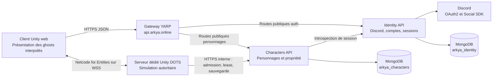

# Architecture Arkya

Arkya utilise Unity DOTS (Data-Oriented Technology Stack) pour la simulation temps réel et Netcode for Entities pour le multijoueur sous autorité serveur. La simulation, exécutée par un serveur dédié Unity, est séparée des services ASP.NET Core qui possèdent les comptes et les données persistantes. La décision sur ces services est détaillée dans [0002 — Services backend](decisions/0002-backend-services.md).

## Vue d'ensemble

La cible réseau et services est détaillée dans [Backoffice et déploiement des realms](REALM_DEPLOYMENT.md) : Traefik VM → YARP public → frontend/backoffice/API, avec des endpoints de jeu distincts. La [bêta web](WEB_BETA.md) ajoute WSS vers un dedicated Unity TCP derrière terminaison TLS, l’admission Characters et les leases de personnages. Les profils UDP et le prototype multi-area restent séparés. Les fichiers de déploiement nécessitent encore leur configuration et leur validation sur l’environnement réel.

Identity et Characters possèdent les comptes, sessions et personnages persistants. La [scène Unity de création](CHARACTER_CREATION.md) branche leur création, liste et apparence sur ces services. Le web reçoit la session Arkya du site après connexion Discord, choisit une destination Realms et demande une admission à usage unique avant d’entrer sur l’île dédiée. Un [prototype Unity isolé](AREA_PROTOTYPE.md) conserve deux processus serveurs et deux clients sur une carte continue, avec transferts d’autorité et combat interzone ; son intégration avec cette admission reste à réaliser. Le bootstrap historique conserve son parcours décrit dans [Enter World](ENTER_WORLD_FLOW.md).

L’entrée publique préparée est maintenant **`api.arkya.online`**, avec [une gateway YARP](../backend/deploy/gateway/README.md). Le Traefik externe termine TLS et joint le LoadBalancer de la gateway à `192.168.100.218:80`. YARP transmet les chemins publics existants aux services sans ajouter de préfixe et sans rediriger le navigateur vers une adresse interne. Identity passe en ClusterIP via son profil `gateway`, avec un callback Discord sur `https://api.arkya.online/v1/auth/discord/callback`. Les anciens profils directs `identity.arkya.online` restent disponibles pour une installation sans gateway ; ils ne doivent pas occuper la même IP simultanément.

La confiance dans les en-têtes HTTPS est contrôlée séparément à chaque saut : réseau source Traefik dans la gateway, réseau des pods gateway dans Identity/Characters. YARP remplace les en-têtes transférés à partir du contexte normalisé. Les liaisons HTTP Traefik→gateway et gateway→Identity sont limitées aux réseaux privés autorisés ; les API internes interservices conservent leurs exigences TLS et clés de service. Les NetworkPolicies limitent l’entrée dans Identity aux pods gateway. Le port de gestion séparé expose les sondes kubelet : la readiness Identity teste MongoDB, celle de la gateway teste seulement son propre processus. Identity conserve son réplica et son volume de clés Data Protection. Le routage Characters s’active lorsque sa destination et ses dépendances sont déployées ; aucun déploiement Characters n’est inventé par ces manifests. Ces fichiers restent à appliquer au cluster.

Le [profil initial frontend et Discord](../backend/deploy/gitops/frontend-discord/README.md)
reprend le modèle `arksaas-infra` : frontend et gateway sur deux LoadBalancers
privés, Identity en ClusterIP et Traefik existant géré séparément. Il hérite
des images de la bêta, mais ne rend que ces trois services ; les routes Admin
et Characters sont désactivées. L'Application Argo `arkya-services` pointe
directement vers ce profil, avec destination `arkya-identity` et une seule
source. La bêta complète conserve son profil distinct,
avec ingress site et deuxième source Unity.

## Client et serveur dédié Unity

La [conception du combat et des classes](GAMEPLAY_CLASSES.md) prévoit Warrior, Scout, Mage, Cleric et Druid, une classe active à la fois, des sorts hérités des autres classes et un rating de niveau global. Elle distingue les règles confirmées des choix encore ouverts ; ce système de progression n'est pas encore implémenté.

Les [familiers totems](GAMEPLAY_TOTEMS.md) ajoutent une direction confirmée : chaque joueur se lie dès le départ à une âme animale, avec le loup et le renard comme premières espèces. Les assets riggés et leurs pelages relèvent de la présentation. Le choix persistant, l'apparition et les règles de gameplay restent à intégrer sous autorité serveur.

Le client possède les entrées, le rendu, l'interface, l'audio, les animations, le chargement des assets et la prédiction locale. Le serveur dédié possède la vérité pour le mouvement, les combats, les interactions, les apparitions, l'inventaire, l'économie et la progression. Les entités distantes sont interpolées, sauf besoin explicite de prédiction.

La simulation s'appuie sur Unity DOTS : Entities (ECS), le C# Job System et Burst. Netcode for Entities assure la réplication réseau, la prédiction locale et la réconciliation sous autorité serveur. Les composants de données restent compacts, les systèmes sont séparés par monde client/serveur, les changements structurels passent par des Entity Command Buffers (ECB) et la présentation observe la simulation. Les MonoBehaviours restent adaptés à l'authoring, au bootstrap, aux caméras et à l'UI.

La [première base d'inventaire et de récolte](GAMEPLAY_FOUNDATION.md), dans `Unity3D/Arkya/Assets/Arkya/Gameplay/`, fournit des statistiques, jusqu'à 150 emplacements, le portage, les nœuds de ressources et les effets d'outils/pierres. `HarvestSystem` applique les demandes uniquement en monde serveur ; son authoring doit être placé dans une SubScene. Cette base reste indépendante de l'île et du prototype : aucune UI, RPC, association de connexion, migration d'area ou persistance n'est encore branchée. `CharacterStats.Health` concerne ces entités indépendantes ; le combat du prototype conserve son unique état de vie dans `PrototypeActor.Health`. Leur future intégration devra unifier cette propriété, sans ajouter une seconde source de vérité sur un même acteur.

Le serveur dédié demande les données initiales et transmet les mutations persistantes à leurs services propriétaires. Le client ne fournit jamais un résultat de combat, un solde ou un inventaire faisant autorité. La première persistance de progression concerne les quêtes de type « tuer N ennemis » : sauvegardes regroupées, concurrence optimiste et retries idempotents. Les autres mutations de gameplay restent à définir.

### Création, apparence et entrée sur l’île

La scène `Assets/Arkya/Characters/Scenes/CharacterCreation.unity`, dans `Unity3D/Arkya/`, réunit l'interface UI Toolkit, le client HTTPS Identity/Characters et la présentation des modèles Humain/Elfe. Le rig Generic, les matériaux peints, la taille visuelle et les animations Idle/Walk/Run/Jump/SwimIdle/Swim appartiennent à la présentation. Ils ne possèdent aucune statistique autoritaire. Le choix de taille applique une échelle visuelle et ne change pas les collisions ou la vitesse.

`CharacterServiceClient` ouvre la connexion Discord dans le navigateur système et conserve la session Arkya et son expiration en mémoire. L'activation sociale ajoute un jeton d'accès Discord et un ticket de renouvellement en mémoire, via une autorisation distincte. Le client n'embarque ni secret Discord, ni clé de service, ni accès MongoDB. La création transmet un contrat d'apparence versionné ; Characters le valide et choisit le propriétaire à partir de la session.

L'essai local crée ses propres mondes serveur/client Netcode sur loopback, port 17843. Le client envoie des intentions de déplacement par RPC ; le serveur vérifie la connexion, les séquences, les valeurs et les bornes avant de simuler le mouvement. La présentation lit un ghost interpolé pour placer et animer le modèle. Ces mondes sont détruits au retour à la création et restent séparés du prototype d'areas. Cet essai ne constitue pas une admission d'un personnage MongoDB dans un realm. Voir le [guide de création](CHARACTER_CREATION.md) pour les assets, la configuration et les limites.

Le bouton **Explorer l’île** charge `StarterIsland` de façon additive et conserve l’UI, la session et l’apparence de création. Le serveur possède une copie immuable du relief et applique les déplacements, les pentes, les sauts, la gravité, la nage et les obstacles statiques ; le client ne transmet aucune position. Chaque pression de saut porte une séquence consommée une seule fois par le serveur ; la vitesse verticale et la phase de traversée restent locales au serveur. Le champ de mouvement répliqué sélectionne la présentation au sol, en l’air ou dans l’eau. La nage utilise le niveau marin moyen ; les vagues restent visuelles. L’[essai natif local](world/STARTER_ISLAND_PLAYABLE.md) conserve ses deux mondes loopback, détruits avant de libérer le terrain et de décharger l’île.

En WebGL, `CharacterWebSessionBridge` reçoit la session du site et Unity la revalide ; aucun essai loopback n’est autorisé. Après sélection du realm/personnage, Characters délivre un ticket court. `CharacterNetworkWorlds` crée uniquement un client WebSocket ; `CharacterServerAdmissionSystem` consomme ce ticket via HTTPS avant `ConnectionApproved` et le spawn du ghost. L’identité et l’apparence répliquées viennent de la réponse serveur. Chaque ghost porte un propriétaire Netcode, tandis que la présentation interpole tous les acteurs et réserve les entrées/caméra au personnage possédé.

Le dedicated charge une copie de l’île avec colliders préparés avant stripping. Il réutilise la simulation ECS de terrain et les collisions statiques Unity, renouvelle la lease toutes les 20 secondes et sauvegarde position/orientation toutes les 15 secondes ainsi qu’à la fermeture. Les écritures sont conditionnées par lease, époque et révision. Une expiration ou un refus d’autorité arrête l’acteur. Le [guide bêta web](WEB_BETA.md) documente builds, configuration, validation et limites : une île par realm, sans intégration des quêtes, de l’inventaire ou des transferts multi-area dans ce parcours.

### Realms et domaines de simulation

Un realm est un univers logique persistant choisi par le joueur. Un personnage appartient à ce realm. Une area est une portion de sa simulation prise en charge par un processus Unity : traverser une frontière d'area conserve le même personnage et le même realm. Le nombre de processus peut évoluer sans changer cette identité. La [décision 0003](decisions/0003-realms-and-area-authority.md) précise cette distinction.

Le combat doit rester continu entre areas voisines d'un même realm. Le serveur propriétaire d'une entité reste seul autorisé à en modifier l'état. Les propriétaires échangent les observations nécessaires aux cibles proches ; celui de la cible valide et applique un impact une seule fois. Une frontière technique ne crée ni arrêt du combat ni nouvelle scène. Un changement de realm est une autre opération, à définir explicitement.

L’[île de départ, niveaux 1 à 6](world/STARTER_ISLAND.md), doit pouvoir disposer de plusieurs copies indépendantes par realm. La destination logique sera `(realmId, zoneId, instanceId)` : une instance conserve le realm du personnage et isole sa simulation des autres copies ; une area reste un domaine d’autorité au sein d’une même copie. L’admission de la bêta vise une seule destination par realm. Son extension aux copies devra préserver les groupes et respecter des capacités mesurées ; réservations et placement multi-instance restent à réaliser.

Son [environnement de présentation](world/STARTER_ISLAND_ENVIRONMENT.md) utilise un cycle visuel de quatre heures, basé sur UTC et corrigeable par un futur échantillon serveur. Le ciel, l’éclairage, les sons et les animations décoratives restent locaux. Toute conséquence du cycle sur les quêtes, apparitions ou récompenses devra être décidée par la simulation serveur ; le composant de ciel ne possède aucun état de gameplay autoritaire.

La [météo de l’île](world/STARTER_ISLAND_WEATHER.md) suit également un calendrier cosmétique déterministe UTC, avec une graine configurable et des transitions progressives. Elle module la présentation existante et ajoute pluie et orages décoratifs. Elle n’ajoute ni état de gameplay autoritaire ni réplication ; une future météo qui influence la simulation devra être possédée par le serveur.

Le prototype actuel emploie des identifiants de test et deux areas fixes sur loopback, sans catalogue de realms ni lien avec les personnages MongoDB. Ses ghosts sont interpolés et chaque client se connecte aux deux serveurs. Son protocole illustre préparation, libération et activation de l'autorité par époque, en conservant l'historique et le registre d'impacts ; il ne fournit pas encore une migration durable ou une gestion d'intérêt adaptée au MMORPG complet.

## Services ASP.NET Core

| Projet | Responsabilité | Données possédées |
| --- | --- | --- |
| `Arkya.Gateway` | Reverse proxy YARP, routes publiques Identity/Characters et backoffice facultatif sur un domaine distinct ; aucune API interne/dev | Aucune donnée métier |
| `Arkya.Identity.Api` | Connexion Discord, identité Arkya, création, validation et révocation des sessions | Comptes, challenges de connexion, sessions dans `arkya_identity` |
| `Arkya.Characters.Api` | Personnages du compte, validation d’apparence, liaison au realm, admission, leases et sauvegarde autoritaire de position | Personnages, admissions et état persistant dans `arkya_characters` |
| `Arkya.Content.Api` | Brouillons de quêtes, validation et publication de catalogues immuables | Révisions et publications dans `arkya_content` |
| `Arkya.Admin` | Interface web authentifiée pour éditer/publier le contenu et créer/déployer/suivre les realms | Aucune donnée métier ; appels serveur vers Content et Realms |
| `Arkya.Realms.Api` | Catalogue opérateur des realms, demandes de déploiement durables et observation des dedicated k3s | Définitions, profils figés et état des opérations dans `arkya_realms` |
| `Arkya.Backend.Api` | Ancien parcours local : annuaire de serveurs mock et connexion de développement | Sessions de développement en mémoire |
| `Arkya.ServiceDefaults` | Bibliothèque technique commune : options MongoDB et authentification des appels de service | Aucune donnée métier |

`Arkya.Realms.Api` fournit le catalogue opérateur et le déploiement de processus dédiés dans des namespaces k3s préautorisés. Son catalogue interne de destinations est désormais exposé aux joueurs authentifiés par Characters. Characters lie atomiquement le personnage à un `realmId` et délivre un ticket seulement pour une destination compatible et activée. Les noms de personnages restent globalement uniques ; l’identité du compte et l’appartenance au realm sont vérifiées côté services.

Les nouvelles API ciblent .NET 10. Chaque service sépare contrats HTTP, règles applicatives et adaptateurs de persistance. Les documents MongoDB restent internes. Un `accountId` Arkya est stable et distinct de l'identifiant Discord ; Characters conserve cette référence sans lire la base Identity.

La gateway conserve l’authentification et les règles métier dans les services. Son allowlist de routes API est explicite : connexion web Identity et endpoints publics Characters. Un routage Admin facultatif dessert exclusivement son domaine configuré, distinct de `api.arkya.online` ; les API Content et Realms restent internes. Les routes Social SDK restent hors de cette exposition web. Les futures routes doivent être ajoutées volontairement et testées. Les workflows GitHub Actions construisent et publient séparément les images Identity, Gateway, Admin et Realms dans GHCR.

Un même processus MongoDB peut héberger les deux bases en développement. Chaque service reste seul propriétaire de sa base : pas de jointure entre bases ni de lecture directe des collections d'un autre service. En déploiement, fournir des comptes MongoDB limités à leur base ; les identifiants administrateur du Compose servent uniquement au développement local.

### Identity et Discord

Le fournisseur initial est Discord, avec le flux OAuth2 Authorization Code et le seul scope `identify` pour la connexion du compte Arkya. Le secret de l'application Discord et l'échange du code restent dans Identity. Ce parcours de connexion ne transmet aucun jeton Discord au client Unity. Ce fonctionnement suit les mécanismes documentés par [Discord OAuth2](https://docs.discord.com/developers/topics/oauth2).

Le protocole Arkya relie le client natif au navigateur :

1. Le client génère un `codeVerifier` aléatoire, conservé localement, et envoie son empreinte S256 à `POST /v1/auth/discord/challenges`.
2. Identity renvoie une URL d'autorisation sous son propre domaine et un challenge valable cinq minutes.
3. Le navigateur ouvre cette URL. Identity crée un état OAuth à usage unique et un cookie de corrélation `Secure`, `HttpOnly`, `SameSite=Lax`, puis redirige vers Discord.
4. Discord revient sur le callback HTTPS fixe d'Identity. Identity vérifie l'état et le cookie, échange le code et associe le compte Arkya au compte Discord.
5. Le client interroge `POST /v1/auth/discord/exchange` avec le challenge et son vérificateur. La réponse est en attente (`202`) ou fournit une session Arkya, une seule fois (`200`).

La preuve S256 appartient au protocole de remise Arkya ; elle ne présume pas d'un support PKCE chez Discord. Une session Arkya est un jeton opaque aléatoire dont seule l'empreinte est persistée. Sa durée par défaut est de huit heures. Expiration et révocation sont vérifiées lors des lectures, indépendamment du nettoyage différé par index TTL MongoDB.

`GET /v1/auth/me` et `POST /v1/auth/logout` reçoivent la session via `Authorization: Bearer`. Les services utilisent `POST /internal/sessions/introspect`, protégé par une clé de service. Characters demande cette validation à Identity pour chaque accès authentifié ; une panne Identity empêche l'accès plutôt que d'accepter une identité non vérifiée.

### Social Discord

Le [Social SDK Discord](DISCORD_SOCIAL.md) possède les relations d'amitié, la présence et les salons sociaux. Son adaptateur desktop reste côté présentation Unity, séparé d'ECS et exclu des builds `UNITY_SERVER`. Le bouton **Amis Discord** est intégré à la création de personnage et à l'essai local ; aucune interface de chat ou de voix n'est encore fournie.

Le client demande une autorisation SDK avec PKCE et les scopes `openid sdk.social_layer identify`. Les routes HTTPS `/v1/auth/discord/social/config`, `/exchange` et `/refresh` exigent une session Arkya. Identity échange le code avec son secret, vérifie que le compte Discord est celui de la session et protège le refresh token dans un ticket lié à cette session. Seuls le jeton d'accès social et ce ticket opaque sont remis au client, en mémoire. Les relations sociales ne sont pas copiées dans MongoDB.

Une invitation rejoint exclusivement un lobby Discord. Son secret est validé par le client comme une destination sociale non fiable ; il ne contient ni personnage, ni realm, ni droit d'admission. Les groupes de gameplay, guildes, règles d'accès et mutations persistantes restent sous autorité Arkya. L'accès aux lobbies requiert les scopes de communication et reste soumis aux quotas de développement puis à l'approbation Discord pour la production.

### Characters

Les routes authentifiées permettent de créer et lire les personnages appartenant au compte de la session. L'`accountId` vient d'Identity, jamais du corps envoyé par le client. La route interne de résolution vérifie également la session et la propriété du personnage ; elle prépare le futur chargement par le serveur dédié. Le catalogue public d'apparence, en lecture seule, ne contient aucune donnée de compte.

L'apparence version 1 contient `race`, `silhouette`, `heightCm`, `skin`, `hairStyle`, `hairColor`, `eyeColor` et `outfitColor`. Characters impose les identifiants autorisés et les bornes de taille par race, puis conserve ce contrat cosmétique avec le personnage. Les nouveaux documents MongoDB utilisent le schéma 2 ; les documents historiques de schéma 1 sans apparence sont lus avec un profil humain par défaut. La création, la liste, la lecture et la résolution retournent l'apparence complète. Aucun champ d'apparence ne confère de statistique, de vitesse ou de collision différente.

La résolution ne donne pas un droit d'entrée en jeu : elle ne réserve pas un personnage, ne crée pas de bail et n'empêche pas deux connexions simultanées. Les contrats précis, les règles de nommage et les exemples sont dans le [guide backend](../backend/README.md).

La bêta ajoute `realmId` aux personnages et les routes authentifiées `GET /v1/realms` et `POST /v1/characters/{id}/admissions`. Un personnage historique sans realm est lié atomiquement à sa première admission valide ; le client ne peut ensuite changer ce realm. Le dedicated consomme le ticket une seule fois avec une clé liée à son identité, puis reçoit une lease de 90 secondes au plus et une époque d’autorité. Les sauvegardes exigent la lease, l’époque et la révision attendue. Le [contrat web](WEB_BETA_CONTRACT.md) précise les DTO, expirations et garanties de rejeu.

### Contenu et progression des quêtes

L'administration web ASP.NET Razor Pages édite un brouillon complet via Content. Une sauvegarde porte la révision attendue ; une édition concurrente est refusée. Une publication fige cette révision dans un catalogue identifié par UUID, avec `schemaVersion = 1`. Répéter la publication d'une même révision retourne la même version. Le dedicated n'accède jamais directement à MongoDB ni aux brouillons.

Le catalogue est sélectionné explicitement au démarrage par `ARKYA_CONTENT_VERSION`. Les deux areas chargent et valident cette version et leurs progressions avant d'écouter les connexions. Une configuration partielle, une publication inconnue, un schéma incompatible ou une dépendance indisponible empêche le démarrage. Le catalogue reste en mémoire jusqu'à l'arrêt. Le client reçoit uniquement la progression de son joueur, via RPC, et ne possède aucune clé de service.

La tranche V1 prend en charge un seul type d'ennemi, `prototype-monster`, et un objectif borné entre 1 et 10 000 morts. Les nouvelles quêtes sont acceptées automatiquement pour exercer le parcours complet. Le serveur propriétaire de la cible valide sa transition vivant → mort ; un crédit interarea fiable et dédupliqué rejoint le writer de quête fixe du joueur. Le transfert d'autorité de déplacement ne transfère pas ce writer. Les pairs contrôlent la version de catalogue et leur identité de démarrage ; un redémarrage unilatéral impose de relancer la paire.

Characters possède séparément la collection `character_quests`. Une entrée conserve l'identifiant de quête, sa version acceptée, son objectif, sa progression et sa révision. Une nouvelle publication ne remplace pas l'objectif déjà accepté. Les routes internes requièrent un personnage existant et une clé de service ; elles refusent la régression, le changement de règles et les révisions concurrentes. Elles font confiance au dedicated authentifié pour les définitions soumises. Aucun endpoint joueur n'accepte un compteur de morts.

L'administration initiale utilise un mot de passe opérateur, un cookie et une protection antiforgery ; sa clé de publication reste côté serveur et diffère de la clé de lecture du dedicated. La gestion des administrateurs dans Identity et les droits par utilisateur restent à intégrer. Les récompenses, le raccordement des quêtes à l’admission web, l'outbox durable et la reprise après crash ne sont pas couverts. Le guide [contenu des quêtes](QUEST_CONTENT.md) précise les contrats, la configuration et le test de bout en bout.

### Parcours de développement existant

`Arkya.Backend.Api` conserve `GET /health`, `GET /servers` et `POST /dev/auth/login`. Cette dernière route est enregistrée uniquement dans l'environnement `Development`. Ses jetons prévisibles et son stockage en mémoire appartiennent au bootstrap local ; Identity et Characters ne les acceptent pas.

Le bootstrap Unity historique appelle toujours ce parcours. La scène de création fournit `connexion Discord → création/sélection du personnage` avec Identity et Characters ; le web ajoute l’admission réelle dans l’île dédiée. L’essai natif local de locomotion ne délivre aucun droit d’entrée et reste distinct de cette admission.

## Transport entre serveur dédié et services

La première implémentation utilise HTTP JSON sur HTTPS, y compris pour l'introspection et la résolution internes. Cela rend les contrats immédiatement testables sans choisir un protocole en fonction d'un gain supposé. Les appels utilisent des délais bornés et propagent l'annulation aux opérations IO.

gRPC unary est une évolution possible pour des contrats internes très sollicités, après mesure du volume, de la taille des messages, de la latence et des allocations sur le vrai build serveur Unity. Protobuf, la génération de clients et les capacités de streaming sont des atouts de gRPC ; HTTP JSON peut aussi bénéficier d'HTTP/2. Voir la [comparaison Microsoft](https://learn.microsoft.com/en-us/aspnet/core/grpc/comparison?view=aspnetcore-10.0).

Un stream sera justifié par un flux d'événements concret, avec reconnexion, reprise et contrôle de pression définis. La simulation Netcode et ses ticks ne transitent pas dans les API de persistance ; une connexion persistante ne remplace pas une stratégie de sauvegarde.

Les routes internes interservices utilisent `X-Arkya-Service-Key` avec une clé de 32 caractères minimum. Les routes `/internal/game` du dedicated utilisent une clé distincte `X-Arkya-Dedicated-Key`, liée côté Characters à son couple realm/serveur. Elles doivent être accessibles uniquement aux services et aux serveurs autorisés, sur un réseau maîtrisé et avec TLS. Le client distribué ne reçoit jamais ces clés. Avant déploiement public, provisionner les identités et la rotation des secrets adaptées.

## Prochaines frontières

- Valider et déployer le parcours bêta complet sur les vrais domaines : site, build WebGL, API, image Linux dédiée et endpoint WSS.
- Raccorder l’admission et ses leases au prototype multi-area, aux groupes et aux futures copies de l’île.
- Étendre les mutations persistantes au combat, à l’inventaire et à la progression avec leurs garanties de concurrence/rejeu.
- Mesurer capacité serveur, latence navigateur et budgets de contenu avant l’ouverture publique.
- Ajouter les services sociaux, d'économie et d'exploitation au rythme des besoins métier.

La configuration locale, les limites de cette tranche et la vérification se trouvent dans le [README backend](../backend/README.md).
