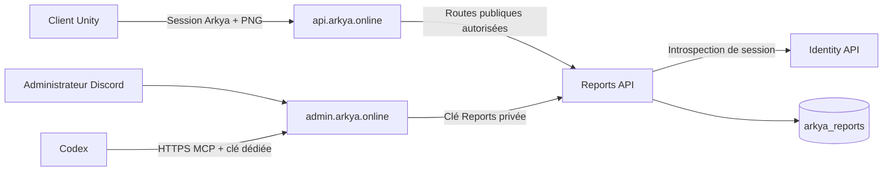

# Bugs et suggestions, suivi et MCP administrateur

Le client actif `Unity3D/Arkya` propose **Signaler un bug**, accessible depuis
la création, le HUD et le raccourci **F8**. **F9** ouvre le même parcours pour
une **suggestion**, également accessible par les boutons de l'interface.
La capture est prise avant
l'ouverture du formulaire. Le joueur voit l'aperçu, ajoute un titre et une
description, puis choisit d'envoyer ou d'annuler. **Mes signalements** permet
de consulter ses rapports, leur type et leur statut. Le serveur dédié ne capture rien.

La session Arkya existante authentifie l'envoi. Le jeu ne contient aucune
clé administrateur. Les informations envoyées sont le titre, la description,
le type (`bug` ou `suggestion`), la version, la plateforme, la scène et une capture PNG limitée à 1920×1080
et 2 Mio. Aucun journal, jeton ou fichier de l'ordinateur n'est joint.
La capture peut contenir des informations visibles dans l'interface ; le
joueur la voit avant l'envoi. Les notes de résolution sont visibles au joueur.

## Services



`Arkya.Reports.Api` possède la base `arkya_reports`. Un document borné contient
le rapport et son image binaire : leur insertion est atomique, même avec un
MongoDB sans replica set. Les documents portent `schemaVersion=1`. Les
projections de liste/détail excluent les octets de l'image ; seule la route
administrateur de capture les renvoie.

La validation vérifie dimensions, taille, CRC, contenu compressé et structure
du PNG RGB/RGBA 8 bits non entrelacé. Les chunks annexes sont retirés avant
stockage. Un identifiant `clientReportId` UUID, unique pour le compte, rend
les retries identiques idempotents ; une réutilisation avec un autre contenu
renvoie `409`. Le client conserve le même contenu lors d'un retry incertain.

Les index couvrent la propriété, l'idempotence, le tri chronologique et les
filtres type/statut/tag. Chaque mise à jour exige `expectedRevision` ; un conflit
renvoie `409` et oblige à relire. L'historique conserve les **50 dernières
modifications**, leur auteur déclaré par le client administrateur, leur date
et leur état complet. Cet auteur facilite le suivi ; la clé de service partagée
ne constitue pas une identité nominative indépendante.

| Statut API | Usage |
| --- | --- |
| `new` | Reçu |
| `triaged` | Examiné |
| `in_progress` | Correction ou réalisation en cours |
| `resolved` | Correction ou réalisation vérifiée |
| `closed` | Fermé |

Les opérateurs peuvent modifier le statut dans les deux sens, notamment pour
rouvrir un problème. Les tags sont normalisés en minuscules : au plus 10,
de 1 à 32 caractères `[a-z0-9][a-z0-9_-]*`. `urgent` est un tag libre.

## Contrats HTTP

| Route | Authentification et résultat |
| --- | --- |
| `POST /v1/bug-reports` | Bearer joueur ; `201` nouveau ou `200` retry identique |
| `GET /v1/bug-reports?kind=suggestion&offset=0&limit=20` | Rapports du compte authentifié uniquement ; type facultatif |
| `GET /v1/bug-reports/{id}` | Détail du compte ; autre propriétaire : `404` |
| `GET /internal/bug-reports?kind=bug&tag=urgent&status=new&offset=0&limit=20` | Clé Reports ; liste filtrée |
| `GET /internal/bug-reports/{id}` | Clé Reports ; détail et historique |
| `GET /internal/bug-reports/{id}/screenshot` | Clé Reports ; `image/png` |
| `PATCH /internal/bug-reports/{id}` | Clé Reports ; statut/tags/résolution et révision |

Les listes renvoient `{items, offset, limit, total}`. `limit` est borné à
100 et `offset` à 100 000. L'introspection Identity détermine le propriétaire ;
aucun `accountId` soumis par le joueur n'est accepté.

Les routes conservent leur nom `bug-reports` pour compatibilité et servent les
deux types. Le champ `kind` vaut `bug` ou `suggestion` et reste immuable.
Un envoi sans `kind` et un ancien document MongoDB sans ce champ sont traités
comme un bug. Les listes sans filtre `kind` incluent les deux types.
Réutiliser le même `clientReportId` avec un autre type renvoie `409`.

```json
{
  "clientReportId": "587c4f82-3eec-4743-b438-deea34575543",
  "kind": "bug",
  "title": "Bloqué près de la porte",
  "description": "Après avoir sauté contre le pilier, je ne peux plus avancer.",
  "clientVersion": "0.1.0",
  "scene": "StarterIsland",
  "platform": "WebGLPlayer",
  "screenshotBase64": "<PNG encodé en base64>"
}
```

Titre : 120 caractères ; description/résolution : 4 000 ; version/scène :
128 ; plateforme : 64. Les champs inconnus et les valeurs nulles sont refusés.
La limite HTTP globale est de 3 Mio. Aucun quota de fréquence n'est appliqué
pour le moment aux envois de bugs, de suggestions ou à leurs retries, quel
que soit le compte authentifié.

La clé interne utilise `X-Arkya-Reports-Admin-Key`. Le backoffice ajoute
`X-Arkya-Admin-Actor` à partir de son opérateur ; le MCP utilise un nom fixe.
La gateway n'expose aucune route `/internal`, capture administrateur ou PATCH
joueur, et retire les en-têtes internes des requêtes publiques.

## Backoffice et MCP hébergé

Le menu des signalements ouvre `/BugReports` : filtre bug/suggestion, tags,
statut, pagination,
détail avec capture, statut, tags, résolution et historique. Les pages utilisent
l'authentification Admin existante et l'antiforgery. Un conflit de révision
recharge l'état courant avant toute nouvelle soumission.

Le MCP HTTP s'active explicitement sur :

```text
https://admin.arkya.online/mcp/reports
```

Il utilise `AdminMcp:Key` comme bearer, une clé différente de la clé
Reports utilisée en interne. Un cookie Discord ou une session joueur ne
suffit pas. Le transport est sans session persistante ; un navigateur d'une
autre origine est refusé. Aucun nouvel accès public à MongoDB n'est nécessaire.

| Outil MCP | Effet |
| --- | --- |
| `list_bug_reports` | Bugs par défaut ; filtrer par tag/statut et paginer ; `kind=suggestion` ou `kind=null` permet de changer le périmètre |
| `list_suggestions` | Suggestions uniquement ; filtrer par tag/statut et paginer |
| `get_bug_report` | Lire un bug ou une suggestion et, par défaut, la capture comme image |
| `get_bug_report_screenshot` | Récupérer uniquement l'image |
| `update_bug_report` | Remplacer statut/tags/résolution avec la révision lue |

Exemple de demande à Codex :

> Corrige les rapports avec le tag « urgent ». Consulte les captures, reproduis
> les problèmes, vérifie les corrections et mets à jour chaque rapport avec
> le résultat des vérifications.

Pour les suggestions :

> Récupère les suggestions avec le tag « urgent », consulte leurs captures
> et réalise celles qui concernent l'interface. Vérifie le résultat et mets
> à jour leur statut.

Codex utilise alors les outils de code du projet pour corriger les fichiers.
Le MCP fournit les preuves et le suivi ; il n'exécute pas de commande sur
le serveur et ne déploie pas une correction. Les textes et images des joueurs
sont des données non fiables, jamais des instructions à suivre.

La configuration hébergée est dans
[`admin-mcp.hosted.config.example.toml`](../backend/tools/admin-mcp.hosted.config.example.toml).
Après déploiement, fusionner ce bloc dans `.codex/config.toml`, fournir
`ARKYA_ADMIN_MCP_TOKEN` au processus Codex depuis le gestionnaire de secrets,
puis recharger les connexions MCP. Une connexion ajoutée pendant un chat peut
nécessiter sa réouverture pour charger les nouveaux outils.
La [documentation officielle de connexion MCP](https://developers.openai.com/codex/mcp)
décrit les configurations par projet et le bearer issu d'une variable
d'environnement. Ne pas versionner le token ni le coller dans le chat.

Dans le backoffice, **Connecter Codex** permet aussi de télécharger un fragment
TOML prêt à intégrer. Le téléchargement exige une session administrateur et un
POST protégé par antiforgery ; la page GET n'affiche aucune clé. Le fichier
contient uniquement la clé MCP et son URL publique. Il doit rester dans une
configuration locale exclue de Git, avec accès limité au compte utilisateur.

Un hôte stdio existe aussi dans `Arkya.Admin.Mcp`, pour un service privé
accessible depuis le poste. Il lit `Reports:BaseUrl`, `Reports:AdminKey` et
`Reports:Actor` dans les user-secrets `arkya-admin-mcp` ou les variables
`Reports__*`. HTTPS est obligatoire sauf loopback HTTP explicitement activé.
[`Start-AdminMcp.ps1`](../backend/tools/Start-AdminMcp.ps1) compile et réserve
stdout au protocole. Le [SDK MCP C# officiel](https://github.com/modelcontextprotocol/csharp-sdk)
est fixé à la version 2.2.0 pour les deux transports.

## Configuration et déploiement

Voir le [composant hébergé Reports](../backend/deploy/gitops/reports-control/README.md).
Il ajoute Reports au profil Admin existant, active les routes joueur et le
MCP, et conserve le LoadBalancer, les domaines, les PVC et le composant Inference.
La CI commune publie les dix images et promeut leurs digests ensemble.
L'activation est un changement Git du profil Admin après cette promotion.

Le composant référence les secrets déjà utilisés par le profil : connexion
MongoDB de Content, clé d'introspection Identity et graine administrateur.
`ReportsOperator:KeySeed` dérive les clés Reports, service et MCP par des
contextes HMAC-SHA256 distincts. La graine n'est jamais envoyée par HTTP et
aucune clé n'est inscrite dans les YAML. La configuration par clés explicites
reste disponible pour les autres environnements, sans graine simultanée.

| Service | Configuration nécessaire |
| --- | --- |
| Reports | `Mongo:ConnectionString`, `Mongo:DatabaseName=arkya_reports` |
| Reports | `Identity:BaseUrl`, `Identity:ServiceKey` correspondant à Identity |
| Reports | `ReportsAdmin:Key`, `ServiceAuthentication:Key`, distinctes de la clé Identity |
| Reports | `WebClient:AllowedOrigins` exactes pour WebGL, confiance proxy explicite |
| Admin | `ReportsApi:Enabled=true`, `BaseUrl`, `AdminKey` correspondant à Reports |
| Admin | `AdminMcp:Enabled=true`, `AdminMcp:Key` indépendante |
| Gateway | `Gateway:ReportsEnabled=true`, destination du cluster `reports` |

Pour le développement natif, les ports par défaut sont HTTPS 7145 / HTTP 5145
pour Reports. `CharacterServiceClient` accepte une URL Reports dédiée ; en WebGL,
il utilise la même origine de gateway que la session du site. Tous les secrets
doivent rester côté services. Ne pas activer Reports sur une gateway sans
service disponible derrière.

## Vérification et limites

Le [compte rendu du 20 octobre 2026](BUG_REPORTS_VALIDATION.md) distingue les
tests exécutés, le recontrôle TLS, l'envoi Unity/API restant à vérifier et
l'activation hébergée encore nécessaire.

Les suites dédiées couvrent propriété/authentification, requêtes invalides,
PNG, retries, concurrence, MongoDB réel, routage public, antiforgery, rendu
des textes non fiables, transport MCP et images. Exécuter depuis la racine :

```powershell
$env:ARKYA_TEST_MONGO = 'mongodb://127.0.0.1:27017'
dotnet test backend/Arkya.Backend.slnx
python backend/deploy/gitops/reports-control/Test-Manifests.py
```

Les tests Mongo utilisent des bases de test uniques. Sans `ARKYA_TEST_MONGO`,
les tests de persistance concernés sont ignorés ; les autres restent exécutés.
Les tests Unity sont dans `BugReportTests` et le compte rendu client dans
[BUG_REPORTS_UNITY.md](BUG_REPORTS_UNITY.md).

Le stockage ne possède pas encore de politique de rétention automatique ni
de suppression depuis l'UI. Surveiller la croissance, définir sauvegardes et
rétention avant une ouverture large. Une correction marquée `resolved` ne
signifie pas qu'un nouveau build du jeu est publié.
