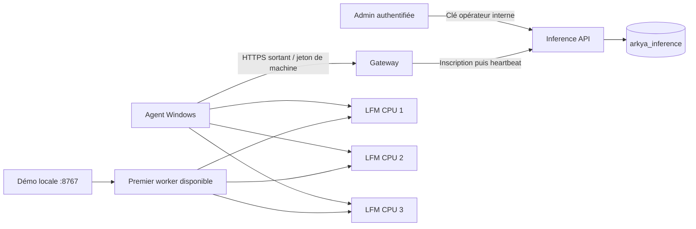

# Agents Windows et workers LFM

Un **agent** représente une machine Windows. Un **worker** est un processus Ollama isolé sur cette machine, avec son modèle et son nombre de threads CPU. Le catalogue initial propose LFM2.5-1.2B-Instruct Q4_K_M et Qwen3.5-0.8B Q4_K_M. Plusieurs PNJ peuvent partager ces workers ; l'identité et les souvenirs d'un PNJ ne résident pas dans le processus du modèle.

Le service `Arkya.Inference.Api` possède la base MongoDB `arkya_inference`. L'administration enregistre la configuration demandée. Chaque agent contacte le service toutes les cinq secondes, transmet les observations et applique la configuration reçue. Une machine hors ligne conserve ses workers et la dernière configuration reçue ; les nouvelles commandes attendent sa reconnexion.



## Préparer le backend

Le package Windows se connecte à une version du backend comprenant ce service. La fonctionnalité reste désactivée par défaut dans Admin et Gateway.

Configuration du service :

| Paramètre | Valeur / rôle |
|---|---|
| `Mongo__ConnectionString` | Secret, compte autorisé sur sa propre base |
| `Mongo__DatabaseName` | `arkya_inference` |
| `InferenceAdmin__Key` | Secret aléatoire de 32 caractères minimum partagé uniquement avec Admin |
| `Inference__MaxWorkers` | `12`, limite globale par machine |
| `Inference__MaxThreadsPerWorker` | `24` |
| `Inference__MaxTotalThreads` | `96`, garde-fou de configuration |
| `Inference__HeartbeatSeconds` | `5` |
| `Inference__OfflineAfterSeconds` | `30` |

Configurer Admin : `InferenceApi__Enabled=true`, `InferenceApi__BaseUrl=<origine du service>`, `InferenceApi__AdminKey=<clé opérateur>`. Le transport est HTTPS ; le HTTP de service Kubernetes exige explicitement `InferenceApi__AllowClusterHttp=true` et les CIDR privés autorisés côté service. L'exception HTTP loopback est réservée à l'environnement Development.

Configurer Gateway : `Gateway__InferenceEnabled=true` et `ReverseProxy__Clusters__inference__Destinations__primary__Address=<origine du service>`. Les routes publiques sont `POST /agent/inference/enroll`, protégée à la première inscription par une clé temporaire, et les POST `/agent/inference/heartbeat`, `/agent/inference/dialogues/claim` et `/agent/inference/dialogues/complete`, authentifiés par le jeton propre à la machine. Les routes `/admin/inference/*` et `/internal/inference/*` restent internes. Gateway retire les clés opérateur et de service envoyées par le client.

Le composant Kubernetes [`backend/deploy/gitops/inference-control`](../backend/deploy/gitops/inference-control/README.md) s'ajoute au profil Admin existant. Il conserve la même Application Argo, les services et les volumes existants. La CI publie l'image Inference avec les huit images déjà livrées, puis promeut leurs neuf digests issus du même commit dans un seul commit GitOps. La première activation du composant intervient après cette publication.

Dans ce profil, Admin et Inference dérivent une clé opérateur dédiée par HMAC-SHA256 à partir de `InferenceOperator__KeySeed`, fourni par la clé `ContentApi__AdminKey` du Secret `arkya-admin-secrets` existant. La graine n'est jamais envoyée comme clé opérateur. Le mode `InferenceAdmin__Key` / `InferenceApi__AdminKey` explicite reste utilisable sur une autre installation ; graine et clé explicite s'excluent. La connexion MongoDB vient du Secret `arkya-content-secrets`, comme pour Characters, avec la base distincte `arkya_inference`. Cet utilisateur MongoDB doit pouvoir créer les collections et index de cette base.

### Si l'inscription renvoie HTTP 404

`Install.cmd` installe l'agent Windows ; le service Inference, les images Admin/Gateway et leur configuration doivent déjà être déployés sur le backend visé. Un `POST /agent/inference/enroll` qui renvoie 404 indique que cette route est absente à l'adresse utilisée. Vérifier l'URL, puis la version de Gateway, `Gateway__InferenceEnabled=true` et sa destination vers `Arkya.Inference.Api`. Une réponse 200 de `/health` confirme seulement que Gateway répond ; elle ne confirme pas l'activation d'Inference.

Après publication des images et activation du composant par GitOps, vérifier que la route répond avec une erreur de validation ou d'authentification à une requête vide, plutôt qu'un 404. La création d'une clé d'installation dans Admin doit également fonctionner avant de reprendre l'installation Windows. Un 502/503 nécessite de vérifier la disponibilité et la readiness du service Inference.

Conserver le dossier d'installation et son identité DPAPI après cet échec. Relancer ensuite la même commande avec le même compte et le même mode d'élévation : l'installateur reprend l'inscription sauvegardée. Une clé temporaire expirée peut être remplacée par une nouvelle clé générée dans Admin, sans remplacer l'identité permanente de la machine.

## Installer et enregistrer automatiquement une machine

1. Ouvrir **Agents LFM** dans l'admin authentifiée.
2. Dans **Connecter une machine**, générer une clé d'installation. Elle est affichée uniquement dans cette réponse et expire après 30 minutes. Aucune machine n'est créée à cette étape.
3. Copier et extraire le ZIP Windows sur la machine.
4. Ouvrir PowerShell en administrateur dans le dossier extrait, puis :

```powershell
.\Install.cmd -BackendUrl https://api.arkya.online
```

Coller la clé d'installation à l'invite sécurisée. L'installateur déduit un identifiant de la machine, génère son jeton permanent, le protège localement avec DPAPI et enregistre automatiquement l'agent dans le backend. La machine apparaît ensuite dans Admin. Par défaut, elle demande **3 workers LFM, 4 threads chacun, maximum 6 workers**. C'est un réglage de départ à mesurer sur le serveur i9-12900K.

La clé d'installation ne figure pas dans les URL, les journaux ni la configuration persistante de l'agent. Le service n'enregistre que son empreinte et la lie atomiquement au premier couple machine/jeton permanent : une autre machine ne peut pas la réutiliser. Les données locales d'inscription sont écrites avant l'appel réseau, permettant de reprendre une réponse perdue sans créer de doublon ni modifier les réglages déjà décidés dans Admin.

Le nom, l'identifiant et la configuration initiale peuvent être fournis explicitement :

```powershell
.\Install.cmd -BackendUrl https://api.arkya.online -AgentId cpu-windows-01 -DisplayName ServeurCPU -InitialWorkers 3 -ThreadsPerWorker 4 -MaxWorkers 6 -ModelId lfm
```

Le modèle est téléchargé une fois dans le cache partagé ; chaque worker charge ensuite son propre contexte. Le formulaire d'enregistrement manuel et `-AgentToken` restent disponibles pour les installations existantes. Une réinstallation de la même inscription conserve son identité et ses réglages du backend.

La démo est accessible sur la machine Windows à `http://127.0.0.1:8767/`, notamment depuis une session Bureau à distance. Les ports des workers sont également limités à loopback. Le pilotage distant de l'agent ne demande pas d'ouverture d'un port entrant sur cette machine. Un éventuel accès à la démo depuis un autre poste doit passer par un tunnel privé.

Les détails des options, du démarrage automatique et de la désinstallation sont fournis dans le `README.md` inclus au ZIP et dans [`backend/tools/inference-agent`](../backend/tools/inference-agent/README.md).

Pour démarrer sans session ouverte sur le serveur, ouvrir PowerShell **en administrateur** : l'installation par défaut utilise `C:\ProgramData\ArkyaInference` et une tâche SYSTEM au démarrage de Windows. Sans élévation, le mode utilisateur démarre à l'ouverture de session. Un superviseur PowerShell retente le lancement de Python trois fois, à dix secondes d'intervalle, après un échec. La tâche configure aussi une reprise du superviseur, avec trois tentatives espacées d'une minute ; la reprise de Python ne dépend pas de cette option du Planificateur. Un arrêt volontaire n'est pas traité comme un crash.

Les scripts `Start-Agent.ps1`, `Stop-Agent.ps1` et `Uninstall-Agent.ps1` détectent l'installation lorsqu'ils sont exécutés depuis son dossier. Depuis un autre dossier, fournir `-InstallDirectory '<chemin installé>'`, particulièrement pour une installation personnalisée.

## Choisir un modèle et modifier les threads

La page Admin affiche le dernier contact, le matériel annoncé, les workers demandés, les processus observés, leurs ports, PID et états. Chaque worker possède un sélecteur de modèle et un champ **Threads**. **Modifier** conserve son identifiant et enregistre sa nouvelle configuration. L'agent le retire de la distribution, laisse finir son dialogue en cours, puis redémarre uniquement ce worker avec ses nouveaux réglages. Les autres workers continuent de répondre. L'ancien modèle et les anciens threads restent visibles tant que le remplacement n'est pas confirmé.

**Ajouter un worker** permet de choisir son modèle et ses threads dès la création. **Supprimer** retire ce worker de la configuration demandée, avec le même arrêt après son dialogue courant. Ces actions s'appliquent au prochain heartbeat ; hors ligne, elles restent en attente. Une demande identique ne force pas de redémarrage.

Le catalogue unique [`InferenceModels.json`](../backend/src/Arkya.ServiceDefaults/InferenceModels.json) est embarqué dans le backend et copié dans le package Windows :

| Identifiant | Modèle | Préparation CPU |
|---|---|---|
| `lfm` | LFM2.5-1.2B-Instruct Q4_K_M | Cache Ollama partagé |
| `qwen35-08b` | Qwen3.5-0.8B Q4_K_M | GGUF texte épinglé par révision et SHA-256, import avec le template sans réflexion |

Le backend et l'agent refusent les identifiants hors catalogue. Les commandes Admin ne peuvent fournir ni chemin, ni URL, ni exécutable arbitraire. Le catalogue reste un fichier livré avec le logiciel ; son extension exige une nouvelle version du backend et de l'agent. Les anciens workers sans champ `modelId` sont interprétés comme LFM.

Mettre à jour les agents avec le package 1.1 avant d'utiliser le choix de modèle : le package 1.0 ne sait exécuter que LFM. Une nouvelle version du backend sait lire ses anciens documents, mais n'ajoute pas cette capacité à un ancien exécutable Windows.

Une erreur de lancement reste visible dans les observations. Une observation « prêt » provenant d'une machine hors ligne est ancienne ; elle ne prouve pas que le processus tourne encore. La page s'actualise explicitement avec le bouton **Actualiser**.

Pour retirer une machine, supprimer ses workers et attendre un heartbeat confirmant leur arrêt, puis supprimer la machine vide. Cette suppression révoque le jeton ; elle ne constitue pas une commande d'arrêt à distance envoyée à une machine déconnectée. Arrêter ou désinstaller aussi l'agent sur Windows. Le backend conserve un marqueur de révocation pour empêcher qu'une ancienne inscription en vol ne recrée la machine. Réutiliser son nom exige une identité locale neuve et une nouvelle clé d'installation ; l'ancienne clé permanente ne peut pas être réactivée.

Les limites prennent en compte les workers dont l'arrêt n'a pas encore été confirmé. Les modifications et les heartbeats utilisent un remplacement conditionnel en MongoDB pour éviter les pertes de commandes concurrentes. L'agent accuse réception de la révision effectivement réconciliée (`appliedRevision`) ; un ancien heartbeat en vol ne confirme pas une commande plus récente. Les observations ont leur propre version de stockage ; la révision de configuration ne change que sur une commande opérateur.

Contrats ajoutés :

| Route | Accès | Rôle |
|---|---|---|
| `GET /admin/inference/models` | Clé opérateur interne | Catalogue autorisé |
| `POST /admin/inference/enrollment-grants` | Clé opérateur interne | Clé d'installation valable 30 minutes, retournée une fois |
| `POST /agent/inference/enroll` | Clé d'installation à la première inscription | `{agentId, displayName, agentToken, initialWorkers, threadsPerWorker, maxWorkers, modelId}` ; reprise possible avec la même identité permanente |
| `PATCH /admin/inference/agents/{id}/workers/{workerId}` | Clé opérateur interne | `{threads, modelId}` ; identifiant de worker conservé |

## Distribution des dialogues et périmètre

La démo utilise un worker libre par dialogue, une requête en cours par worker et une file bornée. Trois demandes simultanées peuvent donc être exécutées par trois processus. Augmenter le nombre de processus partage les ressources CPU et mémoire de la même machine ; le débit n'augmente pas proportionnellement.

Les sorties du modèle sont limitées à une réplique JSON. Les trois choix de la démo sont fournis par le programme ; le champ libre et l'historique sont bornés. La mémoire de la démo est un souvenir de test injecté au prompt. Les transactions, récompenses et souvenirs persistants des PNJ restent sous contrôle des systèmes serveur autoritaires d'Arkya.

## Dialogues PNJ du jeu

Le package **1.2.0** ajoute le parcours `dedicated → Inference → agent Windows → worker local → dedicated`.
Le dedicated fournit le profil du PNJ et le contexte des quêtes depuis son catalogue.
Le texte joueur ne choisit ni prompt système, modèle, URL, quête ni action.
L'agent partage ses workers avec la démo locale, à raison d'une requête en cours
par worker. Les modèles produisent seulement une réplique ; ils n'accordent aucun
objet, récompense, acceptation ou progression de quête.

Configuration Inference : `NpcDialogue__Enabled=true`,
`NpcDialogue__ServiceKey=<secret dédié de 32 à 512 caractères>`.
Configuration du dedicated : `ARKYA_INFERENCE_API_URL=<origine Inference>`,
`ARKYA_INFERENCE_SERVICE_KEY=<même secret>`. Le secret n'est jamais dans un asset
Unity ou le client. Le [composant facultatif de déploiement](../backend/deploy/gitops/npc-dialogue/README.md)
fournit les références de secrets, le câblage Realms et l'accès réseau privé.
Il reste désactivé tant que les images, agents et secrets ne sont pas prêts.

| Route | Accès | Contrat |
|---|---|---|
| `POST /internal/inference/dialogues` | `X-Arkya-Service-Key`, dedicated seulement | `{requestId,npcId,displayName,role,personality,playerMessage,questContext}` |
| `GET /internal/inference/dialogues/{requestId}` | Même clé interne | État et réponse de la demande |
| `POST /agent/inference/dialogues/claim` | Bearer machine | `{agentId,workerId}` → `{job:null}` ou `{job:{requestId,leaseToken,expiresAt,request}}` |
| `POST /agent/inference/dialogues/complete` | Bearer de la machine ayant reçu le bail | `{agentId,workerId,requestId,leaseToken,reply,error}` |

`requestId` est un UUID au format `N` (32 chiffres hexadécimaux). `npcId` contient
1–64 lettres/chiffres ASCII, tirets ou soulignés. Les champs sont du texte simple
sur une ligne : nom ≤80, rôle ≤120, personnalité ≤800, question ≤256, contexte
des quêtes ≤1000 caractères. Le contexte est obligatoire mais peut être vide.
Il n'y a pas d'historique persistant ni d'identifiant de compte dans ces requêtes.

POST et GET retournent `{requestId,status,reply,error}` : HTTP 202 pour `pending`,
HTTP 200 pour `completed` ou `failed`. La réplique est du texte simple de 512
caractères maximum ; le dedicated et le client la présentent sans interpréter
de commandes ou de balises. Répéter une demande identique renvoie le même résultat ;
réutiliser son UUID avec un autre contenu échoue en 409. Une complétion répétée
ne remplace pas la première réponse.

La file conserve au plus **128** demandes, expire le travail à **45 secondes**,
puis conserve le résultat jusqu'à **120 secondes** depuis sa création. Ces limites
sont configurables par `NpcDialogue__Capacity`, `__TimeoutSeconds` et
`__RetentionSeconds`. La saturation renvoie 429 ; aucun agent 1.2 récent et prêt
renvoie 503 immédiatement. Un résultat expiré porte `inference_timeout` et un
échec worker `inference_failed`. Le jeu conserve alors le salut écrit du PNJ et
affiche une indication d'indisponibilité, tout comme après une réponse HTTP
indisponible ou inconnue. Aucun gain ni progression ne dépend de la réponse.

Un bail est lié à la machine, à sa clé permanente et au worker. Un autre worker,
une autre machine ou une identité révoquée ne peut le compléter. Le timeout
n'est pas relancé automatiquement sur un second worker. Les corps, prompts,
répliques et clés ne sont pas journalisés.

Le coordinateur est volontairement temporaire et exige **une seule réplique
Inference**, sans chevauchement lors d'un redéploiement. Un redémarrage efface la
file et laisse le salut écrit disponible. Le catalogue PNJ, le gameplay et la progression
restent indépendants de cette file. Une queue distribuée et une mémoire de PNJ
persistante constituent des évolutions séparées.

## Vérifier et reconstruire

```powershell
dotnet test backend/tests/Arkya.Inference.Tests/Arkya.Inference.Tests.csproj
dotnet test backend/tests/Arkya.Admin.Tests/Arkya.Admin.Tests.csproj --filter 'FullyQualifiedName~Inference'
dotnet test backend/tests/Arkya.Gateway.Tests/Arkya.Gateway.Tests.csproj
python backend/deploy/gitops/inference-control/Test-Manifests.py
python -m unittest discover -s backend/tools/inference-agent/tests -v
```

Les tests de persistance réelle s'activent avec `ARKYA_TEST_MONGO` et créent uniquement des bases de test temporaires. La CI backend dispose déjà de MongoDB pour ces tests. Le script `Build-Package.ps1` reconstruit le ZIP et son manifeste d'intégrité ; les modèles, jetons, configurations de machine et journaux sont exclus du package source.

Validation locale du 20 octobre 2026, package 1.1 : les suites Inference (57), Admin (294), Gateway (151) et agent Windows (20) passent, soit 522 tests. Les scripts sont aussi analysés par Windows PowerShell 5.1 ; les tests de l'agent exercent réellement DPAPI, les jobs Windows et la supervision PowerShell. Une CI Windows dédiée conserve ces vérifications ; les tests Linux utilisent le même Python 3.13.7 que le package.

Le package avec runtimes inclus a été installé avec une clé temporaire, sans identifiant préparé ni création préalable de machine dans Admin. L'agent a été enregistré à partir du nom Windows puis a lancé ses trois workers. La reprise idempotente a conservé les réglages ; la réutilisation de la clé par une autre machine a été refusée.

Le changement d'un worker LFM de quatre threads vers Qwen à deux threads a été effectué dans la page Admin : son identifiant est resté stable, son PID a changé et les autres PID ont été préservés. Trois dialogues simultanés ont utilisé le pool mixte. Une modification de Qwen à trois threads pendant son dialogue a attendu sa réponse avant le remplacement. Répéter la même configuration n'a pas modifié la révision. La réinstallation sous Windows PowerShell 5.1 a conservé l'identité et cette configuration décidée dans Admin. Le backend utilisait MongoDB réel et a également relu les documents de la version précédente. Admin et la démo ont été inspectés en bureau et à 390 pixels sans débordement horizontal de la page.

Cet essai utilise le démarrage supervisé en session utilisateur. Le redémarrage complet d'un serveur Windows avec une tâche SYSTEM n'a pas été exécuté sur la machine distante.

Le package 1.1.1 précise les diagnostics d'inscription HTTP 404, 502 et 503 sans afficher de stack PowerShell. Un test supplémentaire exerce ces trois échecs puis une reprise réussie avec la même identité DPAPI. Le package 1.1 reste compatible avec le backend ; cette mise à jour améliore uniquement le diagnostic d'installation.

Le raccordement PNJ du package 1.2 a été vérifié avec les suites Inference
(63 passants, 3 intégrations Mongo ignorées faute de `ARKYA_TEST_MONGO`), Gateway
(273), Realms (435 passants, 5 intégrations Mongo ignorées) et agent Windows
(21 existants et 7 nouveaux tests de dialogue). Le rendu du composant facultatif
confirme les références de secrets, les règles réseau/RBAC et la conservation
des ressources préexistantes. Le ZIP 1.2 a également été reconstruit.

Un worker LFM réel isolé, sur CPU avec quatre threads et les poids existants,
a répondu au profil d'Aline en 10,171 s : « Je suis Aline, la garde de la ville
d'Aubefont. Je surveille la place et accueille les visiteurs. » Pour Maëlle,
la demande d'or et de complétion des quêtes a produit en 8,929 s : « Je ne peux
pas vous donner d'or ni terminer vos quêtes. » Les sorties ont respecté le JSON
et la longueur, et l'absence de mémoire GPU a été vérifiée. Ce processus détenu
par le test a été arrêté ensuite. Cet essai valide le prompt et l'adaptateur
du vrai modèle ; il ne remplace pas la validation du parcours complet sur les
services déployés et les machines distantes. Aucun déploiement ni agent installé
n'a été modifié par cette vérification.
