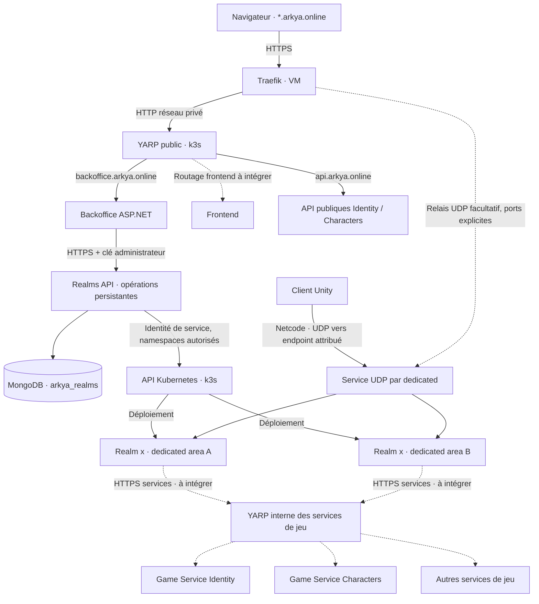

# Réseau, backoffice et déploiement des realms

La cible reprend le schéma fourni le 16 octobre 2026 : une VM Traefik reçoit les domaines Arkya, une gateway YARP dessert les applications web, et les serveurs dédiés d'un realm appellent les services de jeu par une gateway interne. Le premier parcours implémenté est l'administration des déploiements k3s.

Pour l'installation progressive actuelle, le [profil Argo `admin`](../backend/deploy/gitops/admin/README.md)
ajoute les modules Quêtes et Realms sur `admin.arkya.online`, avec les six
applications dans `arkya-beta` et un seul LoadBalancer YARP. Il autorise
explicitement HTTP privé entre Admin et ses API ; la topologie HTTPS interne
décrite ci-dessous reste disponible dans le profil bêta complet. Le déployeur
de dedicateds n'est activé qu'à une étape ultérieure.

## Topologie et responsabilités



Les pointillés signalent les intégrations restantes ou facultatives. L'UDP représenté est le transport cible ; cette tranche ne branche pas le client Unity sur ces endpoints. Le frontend existant reste publié séparément tant que son hébergement et son routage n'ont pas été raccordés.

| Élément | Rôle |
| --- | --- |
| Traefik VM | TLS des sites et API ; relais UDP éventuel configuré séparément |
| YARP public | Routage HTTP par domaine ; séparation de `api.arkya.online` et du backoffice |
| Backoffice `Arkya.Admin` | Connexion opérateur, édition des quêtes existante, création et suivi des realms |
| `Arkya.Realms.Api` | Définitions persistantes, demande de déploiement, observation des ressources Kubernetes |
| Realm | Univers logique stable, associé pour cette V1 à un namespace préautorisé |
| Dedicated | Un processus de simulation par area explicitement nommée ; une réplique par processus |
| YARP interne | Cible de routage HTTP des services de jeu ; instance et routes restant à implémenter |
| Identity / Characters | Services propriétaires des comptes et personnages ; aucune copie implicite par realm |

YARP est un proxy HTTP de couche 7 ; il ne transporte pas les datagrammes Netcode. Un relais UDP Traefik exige ses propres entryPoints et destinations. Un nom `realm-x.arkya.online` ne suffit pas à choisir une destination dans un flux UDP : les endpoints annoncés devront préciser l'adresse et le port. Voir les documentations [YARP](https://learn.microsoft.com/en-us/aspnet/core/fundamentals/servers/yarp/https-tls?view=aspnetcore-10.0), [Traefik UDP](https://doc.traefik.io/traefik/reference/routing-configuration/udp/routing/router/) et [Services Kubernetes](https://kubernetes.io/docs/concepts/services-networking/service/).

## Première tranche disponible

L'écran **Realms** réutilise la session opérateur, les formulaires antiforgery et le style du backoffice existant. L'opérateur choisit un identifiant stable, un nom affiché, une cible et un profil fournis par le serveur. Il peut définir les îles du realm, leur découpage entre dedicateds et les capacités prévues pour les instances et les raids. Le profil fixe l'image par digest, les ports et arguments autorisés, ainsi que les références éventuelles aux Secrets déjà présents dans le namespace cible. Le formulaire ne reçoit ni kubeconfig, ni YAML, ni commande libre.

La création enregistre un brouillon dans `arkya_realms`. Le déploiement enregistre d'abord une demande durable ; un worker crée les `Deployment` et `Service` manquants, puis observe leur état. Un redémarrage de Realms reprend les demandes persistées. Chaque processus possède son propre Service UDP `LoadBalancer` ; il n'y a pas de répartition aléatoire entre areas dans un Service commun.

Les états affichés sont `Draft` (brouillon), `Pending` (en attente), `Deploying` (déploiement en cours), `Ready` (déploiement prêt), `Failed` (échec). `Ready` exige la génération observée, une réplique mise à jour et disponible par serveur, et une adresse de LoadBalancer. Cet état ne vérifie ni l'écoute UDP effective, ni l'admission de joueurs, ni les sauvegardes de jeu. Les dedicated générés n'ont pas encore de sonde applicative Unity.

### Îles, partitions, instances et raids

Un realm regroupe les processus de toutes ses îles et les capacités prévues
pour ses instances et raids. À la création, chaque île possède un `islandId`
stable, un `dedicatedCount`, ses dimensions `width`/`depth` et son origine
`originX`/`originZ` dans le plan horizontal X/Z Unity. La liste accepte aussi
les îles futures : aucune règle ne la limite à StarterIsland. Le build Unity
doit disposer du contenu de chaque île ; cette configuration ne crée pas de
terrain.

Une île de 1 000 × 1 000 à l'origine (0, 0), répartie sur quatre dedicateds,
forme quatre domaines d'autorité de 500 × 500 :

| Domaine | Dedicated | X min → max | Z min → max |
| --- | --- | --- | --- |
| A | `island-starter-island-01` | 0 → 500 | 0 → 500 |
| B | `island-starter-island-02` | 500 → 1 000 | 0 → 500 |
| C | `island-starter-island-03` | 0 → 500 | 500 → 1 000 |
| D | `island-starter-island-04` | 500 → 1 000 | 500 → 1 000 |

Chaque domaine possède son processus et son Service, avec une seule réplique
Kubernetes. Quatre replicas derrière un Service partagé ne fournissent pas
ce découpage. Les bornes intérieures sont semi-ouvertes : X = 500 appartient
à la colonne de droite, Z = 500 à la ligne suivante (C/D), et (500, 500) à D.
Les bords extérieurs maximaux de l'île restent inclus. Une position hors de
l'île n'a pas de propriétaire dans ce plan.

Le découpage choisit une grille rectangulaire dont colonnes × lignes égale
exactement `dedicatedCount`, en recherchant les cellules les plus proches du
carré compte tenu des dimensions de l'île. À égalité, il privilégie davantage
de colonnes X. Une île carrée donne donc 2 × 2 avec quatre dedicateds,
3 × 2 avec six, et 5 × 1 avec cinq. Les indices progressent d'abord en X,
puis en Z. Chaque dedicated possède une cellule ; il n'y a ni trou ni
superposition d'autorités aux frontières.

Le profil autorisé sert de modèle. La création développe et fige les
processus, leur type (`kind = Island`, `Instance` ou `Raid`), l'`islandId`,
l'indice `partitionIndex` à partir de zéro, `partitionCount` et les `bounds`
(`minX`, `minZ`, `maxX`, `maxZ`) des partitions. Les autres îles peuvent avoir
des dimensions et une origine différentes. Les documents MongoDB portant
ce plan utilisent le schéma 2 ; les définitions historiques de schéma 1
restent lisibles.

Pour les seuls plans explicites, les manifests injectent
`ARKYA_SERVER_KIND` et `ARKYA_REALM_TOPOLOGY` (JSON camelCase). Les partitions
reçoivent aussi `ARKYA_ISLAND_ID`, `ARKYA_PARTITION_INDEX`,
`ARKYA_PARTITION_COUNT`, `ARKYA_AREA_BOUNDS` (JSON camelCase) et
`ARKYA_AREA_NEIGHBORS` (liste JSON des identifiants voisins partageant un
côté de la même île). Ces données préparent le contrat du runtime ; le build
bêta actuel ne les interprète pas pour effectuer un transfert d'autorité.

Les compteurs `instanceDedicatedCount` et `raidDedicatedCount` prévoient des
emplacements distincts, identifiés par `instance-01`, `raid-01`, etc. Ils
représentent une capacité configurée. L'allocation d'une partie privée à un
groupe, ses droits d'entrée, son état, sa durée de vie et le retour au monde
ouvert restent à implémenter. Ces nombres ne comptent pas des parties
actives et ne garantissent pas des instances jouables.

Une topologie omise conserve exactement les serveurs du profil historique.
Une topologie explicite peut être enregistrée comme brouillon avec ce même
profil, pour préparer le realm. Son déploiement est refusé avec
`topology_runtime_unsupported` tant que le profil ne déclare pas explicitement
un runtime compatible. Cette garde existe à la demande de déploiement et
dans le déployeur, indépendamment du formulaire.

Pour déclarer cette capacité, l'exploitation configure
`Deployment:Profiles[*]:TopologyTemplateServerId` avec l'identifiant d'un
serveur modèle existant. Pour WebSocket, elle fournit aussi
`TopologyPublicEndpointTemplate`, contenant `{serverId}` et éventuellement
`{realmId}`, pour annoncer une destination distincte à chaque processus.
Les routes publiques et leurs destinations doivent être provisionnées
séparément. Chaque endpoint développé doit respecter les limites du protocole,
dont 125 octets pour le chemin WebSocket, et rester distinct après
normalisation URI. Cette déclaration affirme la compatibilité de l'image
autorisée ; elle n'implémente ni handoff, ni allocateur.

Le plan conserve `topologyRuntimeSupported` avec son profil figé. Une
modification de la configuration du profil ne transforme pas automatiquement
les définitions existantes. Tant que le realm est `Draft`, l'opérateur peut
explicitement réenregistrer son plan et choisir un autre profil, avec la
révision attendue. Cela permet de préparer un plan avec le profil bêta, puis
de le rattacher à un runtime compatible. Les états `Pending`, `Deploying`,
`Ready` et `Failed` refusent cette édition : une topologie déjà engagée ne peut
pas être redécoupée sans futur workflow de drain et de migration.

Le build bêta actuel charge une seule StarterIsland par dedicated, sans
transfert entre autorités. Le profil bêta ne déclare donc pas cette
compatibilité. Un plan « StarterIsland = 4 » reste enregistrable et
consultable, mais son déploiement est bloqué avec ce profil. Le catalogue
joueur exclut toutes les topologies explicites, même déclarées compatibles
et déployées : son admission ne sait pas encore router entre îles,
partitions ou parties privées. Le parcours bêta sans topologie explicite
conserve sa destination unique.

### Contrat attendu pour le passage automatique

Le joueur doit conserver son personnage, son realm et son état en traversant
une frontière technique. L'intégration du runtime devra fournir :

1. Une destination persistante comprenant l'île, l'area et l'éventuelle partie
   privée, en plus du realm et des coordonnées. L'admission retrouve cette
   destination ; le client ne choisit pas librement son autorité ou ses droits.
2. Une préparation idempotente avec identifiant de transfert unique. La
   destination valide l'état sans activer un second propriétaire. Le changement
   de lease et l'incrément de l'époque d'autorité sont atomiques ; après commit,
   l'ancien propriétaire ne peut plus écrire cet état persistant.
3. Des répliques frontalières et événements dédupliqués entre voisins pour
   conserver visibilité et interactions. Le propriétaire de la cible applique
   chaque effet une seule fois ; une observation ne confère pas d'autorité.
4. Des pairs authentifiés et liés au même realm, à la même topologie et à des
   versions compatibles. Expiration, annulation avant commit, partition réseau
   et reprise après crash ont une issue définie, sans double propriétaire ni
   perte silencieuse d'état.
5. Une connexion et une présentation clientes qui suivent le changement
   d'autorité en conservant la continuité de l'île et le realm du personnage.

Ces garanties restent à raccorder au parcours bêta. Les compteurs et bornes
du backoffice ne les activent pas. Le [prototype multi-area](AREA_PROTOTYPE.md)
illustre des mécanismes locaux à deux serveurs, avec identités de test et
état de transfert en mémoire ; il n'est pas ce runtime distribué.

### Garanties et limites

La gateway normalise le schéma effectif `wss` en `https` après vérification
du proxy approuvé : Traefik utilise ce schéma lors de l'upgrade WebSocket.
Ce comportement est explicite dans le
[middleware Traefik](https://github.com/traefik/traefik/blob/master/pkg/middlewares/forwardedheaders/forwarded_header.go),
alors qu'[ASP.NET `IsHttps`](https://github.com/dotnet/aspnetcore/blob/v10.0.10/src/Http/Http/src/Internal/DefaultHttpRequest.cs)
compare uniquement le schéma `https`.
La garde HTTPS reste active ; `ws`, HTTP direct et les en-têtes d'un proxy
non approuvé sont refusés. Le test utilise le vrai pipeline de production,
Kestrel et un échange WebSocket binaire ; l'admission du dedicated reste
une vérification distincte.

- Une cible et son namespace ne peuvent appartenir qu'à un realm ; MongoDB impose l'unicité. Le profil est copié dans la définition pour éviter qu'un changement de configuration modifie un realm existant.
- La demande porte `expectedRevision`. Un rejeu avec la même révision retrouve la demande déjà enregistrée ; une autre modification concurrente est refusée. Le worker utilise une version interne distincte pour ses observations.
- Les noms de ressources sont déterministes et portent une identité de déploiement persistante. Une ressource étrangère ou une configuration modifiée manuellement provoque une erreur ; le service ne l'écrase pas.
- Le worker peut créer une ressource absente, y compris après sa suppression externe. Cela relance un processus ; aucune reprise d'état de simulation n'est promise. Désactiver `Deployment:Enabled` avant une intervention de maintenance externe qui doit conserver un serveur arrêté.
- Le worker observe aussi les realms prêts. Une perte de disponibilité quitte l'état prêt. Une erreur définitive ou un délai dépassé demande une nouvelle tentative depuis le backoffice après correction de sa cause.
- Les namespaces et droits sont provisionnés par l'exploitation. Le compte de service a `get/create/patch` sur Deployments et `get/create` sur Services dans ces namespaces, `get` sur les seuls Secrets `arkya-ghcr` et `arkya-dedicated`, et `create` sur les Secrets. `patch` est limité à l'image approuvée et à l'annotation de redémarrage d'un Deployment possédé, avec préconditions de concurrence. Kubernetes ne limite pas `create` par nom ; Realms impose les noms fixes, la cible autorisée et l'identité du realm avant tout appel. Aucun droit de liste, modification ou suppression de Secret ni accès aux autres namespaces n'est accordé. Le Secret de registre source `arkya-beta/arkya-ghcr` doit être provisionné avant le rollout Realms ; voir le [contrat YAML du Secret](REALM_RUNTIME.md#provisionner-le-registre-source).
- Le backoffice permet maintenant le redémarrage, la mise à jour vers une release approuvée et des commandes en jeu ; voir [Exploitation des realms](REALM_OPERATIONS.md). La suppression, l’arrêt permanent et l’autoscaling restent séparés.

Les comptes restent globaux. Le rattachement `realmId` des personnages, les
tickets d'admission et le catalogue joueur existent dans le
[parcours bêta](WEB_BETA.md), limité à une destination par realm. Le plan
multi-île et ses emplacements d'instances/raids restent un contrat
d'administration ; leur routage et leur allocation de gameplay doivent
encore être intégrés.

### Mettre à jour une image par GitOps

Changer seulement `Deployment:Profiles[*]:Image` conserve volontairement l'image
figée des realms existants. Une release d'image doit ajouter une intention
`Deployment:ImageReleases`, vide par défaut. Pour `beta-web`, le ConfigMap
Realms du profil Argo `admin` porte les clés suivantes ; remplacer les deux
digests par ceux vérifiés de la release précédente et de la nouvelle CI :

```yaml
Deployment__Profiles__0__Image: ghcr.io/hantse/arkya-mmorpg-dedicated@sha256:<nouveau-digest>
Deployment__ImageReleases__0__RealmId: beta-web
Deployment__ImageReleases__0__ProfileId: beta-web
Deployment__ImageReleases__0__Version: '1'
Deployment__ImageReleases__0__PreviousImage: ghcr.io/hantse/arkya-mmorpg-dedicated@sha256:<digest-actuel>
```

La version est un entier positif strictement croissant par realm. Le nouveau
digest vient exclusivement du profil autorisé, et la cible doit être liée
explicitement au même `RealmId`. La topologie, les arguments, le protocole,
les identifiants, les références de secrets et le namespace restent identiques.
Une intention qui ne correspond pas au profil figé, à l'image précédente ou
à une version déjà enregistrée est ignorée sans écriture ni déploiement.

Publier ensemble les images client/dedicated issues du même commit CI, puis
committer les pins et cette intention dans le YAML suivi par Argo CD. Le
changement de ConfigMap généré provoque le redémarrage de Realms. Aucun
`kubectl` ni changement direct de MongoDB n'est nécessaire. Mettre également
à jour Characters lorsque le catalogue d'apparence est étendu : l'ancien
dedicated valide ce catalogue et refuse les nouvelles options inconnues.

Le worker attend un realm `Ready` (ou un ancien realm `Failed` sans release
précédente), puis persiste par comparaison
de version l'image et son intention avant de toucher Kubernetes. Cette
écriture retire le realm du catalogue prêt pour interrompre les nouvelles
admissions pendant la transition. Un rejeu conserve la même révision ; un
processus obsolète ne peut remplacer une définition plus récente.

Le patch Kubernetes vérifie le nom déterministe, le namespace, les labels de
propriété et la configuration attendue complète. Seuls l'ancien digest
annoncé et l'annotation `arkya.online/image-release` peuvent changer. Le
`resourceVersion` est testé atomiquement avec l'ancienne image ; l'annotation
de version doit encore correspondre à la transition précédente. Ce verrou
empêche un ancien worker de rejouer une release après un retour volontaire à
un digest historique. Toute autre dérive est refusée, sans modification des
Services ni des Secrets existants.

La stratégie demeure `Recreate`, une seule réplique et 30 secondes de grâce :
le dedicated reçoit `SIGTERM` pour sauvegarder et libérer ses leases avant
le lancement de son remplaçant. Une interruption des connexions est donc
attendue. Après le patch, la readiness précédente est écartée ; la nouvelle
génération doit être observée avec une réplique disponible et l'image
attendue. Le digest prêt est conservé dans `ServerObservation.ReadyImage`.
L'intention persistée reprend après redémarrage ; une release en échec est
revérifiée avec la même intention, sans changer de révision à chaque essai.

Conserver l'intention courante dans Git après réussite. Une configuration
retirée, contradictoire ou de version inférieure ne gère plus un realm déjà
promu et ne le rétrograde pas. Pour revenir à un digest historique, publier
une nouvelle version supérieure avec l'image actuelle comme `PreviousImage`.
Attendre la fin de la release courante avant d'en publier une nouvelle.
Une transition précédente encore en échec ne peut être remplacée par une
version supérieure : restaurer d'abord son intention et terminer sa reprise.
Les validations unitaires couvrent les contrats et le faux cluster ; une
admission dans le vrai client et un arrêt avec lease active restent les
vérifications de déploiement à effectuer sur chaque nouvelle paire.

## Contrats d'administration

Toutes les routes `/admin/realms` sont internes et exigent `X-Arkya-Admin-Key`, fourni par le serveur Admin. Les services refusent HTTP en production ; le backend Realms utilise TLS interne. La clé ne rejoint jamais le navigateur. Les secrets Kubernetes sont des références de configuration, pas des données retournées par l'API.

| Méthode et route | Entrée / résultat |
| --- | --- |
| `GET /admin/realms/options` | Cibles et profils sélectionnables, `topologySupported` par profil, `deploymentEnabled` |
| `GET /admin/realms` | Liste des définitions et états observés |
| `GET /admin/realms/{realmId}` | Détail et endpoints observés par serveur |
| `POST /admin/realms` | `{realmId, displayName, targetId, profileId, topology?}` ; `201` si créé |
| `PUT /admin/realms/{realmId}/topology` | `{expectedRevision, profileId, topology}` ; `200` après édition d'un brouillon |
| `POST /admin/realms/{realmId}/deploy` | `{expectedRevision}` ; `202` si demande acceptée ou retrouvée |

Les identifiants de realm, profil, cible et serveur ont 3 à 31 caractères : lettre minuscule initiale, chiffres/minuscules/tirets, terminaison alphanumérique. Les noms affichés ont 1 à 80 caractères. Une cible ou un realm déjà réservé renvoie `409`, un choix invalide `400`. Les définitions exposent une révision, l'image figée, l'état, une erreur bornée et la date du dernier changement observé.

Exemple de plan : quatre dedicateds pour l'île de départ, deux pour une autre
île, deux emplacements d'instances et un de raid :

```json
{
  "realmId": "eu-one",
  "displayName": "Europe one",
  "targetId": "realm-eu-one",
  "profileId": "island-v1",
  "topology": {
    "islands": [
      {
        "islandId": "starter-island",
        "dedicatedCount": 4,
        "width": 1000,
        "depth": 1000,
        "originX": 0,
        "originZ": 0
      },
      {
        "islandId": "second-island",
        "dedicatedCount": 2,
        "width": 2000,
        "depth": 1000,
        "originX": -1000,
        "originZ": 0
      }
    ],
    "instanceDedicatedCount": 2,
    "raidDedicatedCount": 1
  }
}
```

Une topologie accepte au plus 32 îles, avec des identifiants uniques de 3 à
20 caractères au même format minuscule. Chaque île demande 1 à 64 dedicateds ;
chaque capacité instance/raid accepte 0 à 64 dedicateds. La somme doit être
comprise entre 1 et 256 processus. `width` et `depth` sont finis, de 1 à 1 000 000 ; les origines sont finies,
avec une valeur absolue au plus égale à 10 000 000. Omettre les dimensions
conserve les valeurs par défaut de
1 000 × 1 000 à l'origine (0, 0). `topology = null` ou le champ absent conserve
le contrat historique. Le détail expose `topology`,
`topologyRuntimeSupported` et les métadonnées spatiales des serveurs prévus.
Une création réussie reste un brouillon : elle ne valide ni le contenu du
build, ni ses routes, ni le passage d'un joueur entre dedicateds.

L'édition d'un brouillon réutilise exactement l'objet `topology` ci-dessus,
avec `expectedRevision` et le `profileId` choisi. Elle recalcule le snapshot
complet et incrémente la révision par comparaison atomique. Une révision
périmée renvoie `409` ; un realm hors état `Draft` renvoie `409` avec
`topology_edit_unavailable`. Dans cette requête, `topology` doit être présent ;
`null` revient explicitement aux serveurs du profil historique. L'édition ne
change ni le realm, ni sa cible, ni le rattachement des personnages.

Le mot de passe opérateur unique est conservé pour cette tranche, comme pour les quêtes. Les comptes d'administration individuels, rôles fins et journal d'audit nominatif restent à ajouter avant d'élargir les accès.

## Exploitation et vérification

Le [guide k3s](../backend/deploy/realms/README.md) décrit les images, secrets, certificats, profils, permissions et la mise en service du backoffice. Le déploiement est désactivé par défaut. Les tests .NET exercent les contrats, autorisations, conflits, reprise, observation Kubernetes et l'interface via des dépendances simulées ; le script PowerShell contrôle les manifests hors ligne.

La validation finale d'un realm réel doit démarrer une image Linux dedicated
compatible, confirmer ses endpoints depuis l'extérieur et faire entrer un
client avec le protocole d'admission adapté. Les builds Windows du prototype
local ne constituent pas cette image. Le déploiement du backoffice ne prouve
pas cette intégration de jeu.

Pour une île répartie sur plusieurs dedicateds, la validation doit en plus
faire traverser un vrai client dans les deux sens, vérifier une seule autorité
par entité, la continuité des interactions frontalières, le refus des
écritures de l'ancien propriétaire et la persistance après transfert. Les
retries, timeouts, paquets dupliqués, arrêt d'un voisin et reprise après crash
doivent être exercés sur les processus distribués. Les instances et raids
nécessiteront leurs propres tests d'allocation de groupe, d'accès et de retour.
