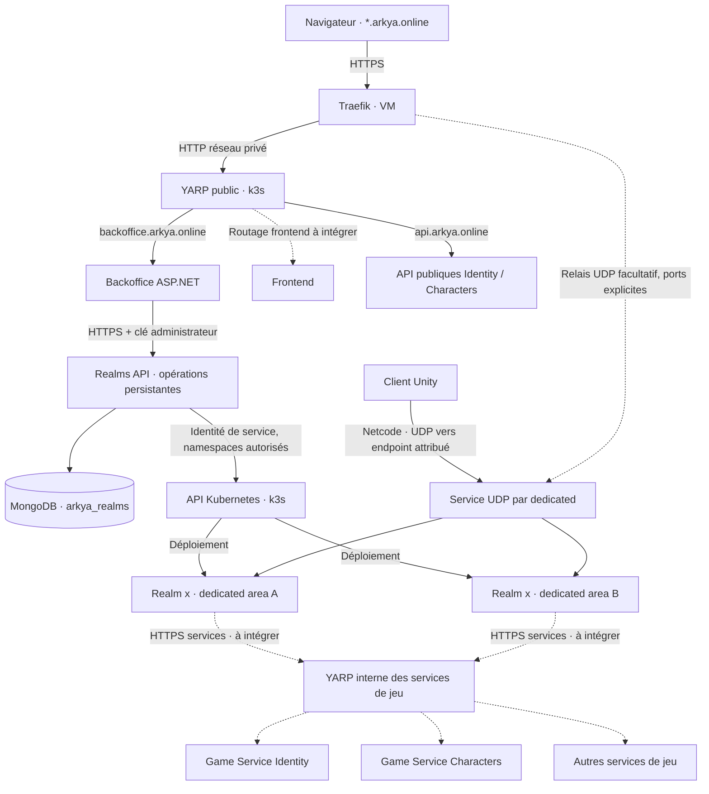

# Réseau, backoffice et déploiement des realms

La cible reprend le schéma fourni le 16 octobre 2026 : une VM Traefik reçoit les domaines Arkya, une gateway YARP dessert les applications web, et les serveurs dédiés d'un realm appellent les services de jeu par une gateway interne. Le premier parcours implémenté est l'administration des déploiements k3s.

Pour l'installation progressive actuelle, le [profil Argo `admin`](../backend/deploy/gitops/admin/README.md)
ajoute les modules Quêtes et Realms sur `admin.arkya.online`, avec les six
applications dans `arkya-beta` et un seul LoadBalancer YARP. Il autorise
explicitement HTTP privé entre Admin et ses API ; la topologie HTTPS interne
décrite ci-dessous reste disponible dans le profil bêta complet. Le déployeur
de dedicateds n'est activé qu'à une étape ultérieure.

## Topologie et responsabilités

Les pointillés signalent les intégrations restantes ou facultatives. L'UDP représenté est le transport cible ; cette tranche ne branche pas le client Unity sur ces endpoints. Le frontend existant reste publié séparément tant que son hébergement et son routage n'ont pas été raccordés.

| Élément | Rôle |
| --- | --- |
| Traefik VM | TLS des sites et API ; relais UDP éventuel configuré séparément |
| YARP public | Routage HTTP par domaine ; séparation de `api.arkya.online` et du backoffice |
| Backoffice `Arkya.Admin` | Connexion opérateur, édition des quêtes existante, création et suivi des realms |
| `Arkya.Realms.Api` | Définitions persistantes, demande de déploiement, observation des ressources Kubernetes |
| Realm | Univers logique stable, associé pour cette V1 à un namespace préautorisé |
| Dedicated | Un processus de simulation par area explicitement nommée ; une réplique par processus |
| YARP interne | Cible de routage HTTP des services de jeu ; instance et routes restant à implémenter |
| Identity / Characters | Services propriétaires des comptes et personnages ; aucune copie implicite par realm |

YARP est un proxy HTTP de couche 7 ; il ne transporte pas les datagrammes Netcode. Un relais UDP Traefik exige ses propres entryPoints et destinations. Un nom `realm-x.arkya.online` ne suffit pas à choisir une destination dans un flux UDP : les endpoints annoncés devront préciser l'adresse et le port. Voir les documentations [YARP](https://learn.microsoft.com/en-us/aspnet/core/fundamentals/servers/yarp/https-tls?view=aspnetcore-10.0), [Traefik UDP](https://doc.traefik.io/traefik/reference/routing-configuration/udp/routing/router/) et [Services Kubernetes](https://kubernetes.io/docs/concepts/services-networking/service/).

## Première tranche disponible

L'écran **Realms** réutilise la session opérateur, les formulaires antiforgery et le style du backoffice existant. L'opérateur choisit un identifiant stable, un nom affiché, une cible et un profil fournis par le serveur. Le profil fixe l'image par digest, les processus, leurs ports et arguments, ainsi que les références éventuelles aux Secrets déjà présents dans le namespace cible. Le formulaire ne reçoit ni kubeconfig, ni YAML, ni commande libre.

La création enregistre un brouillon dans `arkya_realms`. Le déploiement enregistre d'abord une demande durable ; un worker crée les `Deployment` et `Service` manquants, puis observe leur état. Un redémarrage de Realms reprend les demandes persistées. Chaque processus possède son propre Service UDP `LoadBalancer` ; il n'y a pas de répartition aléatoire entre areas dans un Service commun.

Les états affichés sont `Draft` (brouillon), `Pending` (en attente), `Deploying` (déploiement en cours), `Ready` (déploiement prêt), `Failed` (échec). `Ready` exige la génération observée, une réplique mise à jour et disponible par serveur, et une adresse de LoadBalancer. Cet état ne vérifie ni l'écoute UDP effective, ni l'admission de joueurs, ni les sauvegardes de jeu. Les dedicated générés n'ont pas encore de sonde applicative Unity.

### Garanties et limites

- Une cible et son namespace ne peuvent appartenir qu'à un realm ; MongoDB impose l'unicité. Le profil est copié dans la définition pour éviter qu'un changement de configuration modifie un realm existant.
- La demande porte `expectedRevision`. Un rejeu avec la même révision retrouve la demande déjà enregistrée ; une autre modification concurrente est refusée. Le worker utilise une version interne distincte pour ses observations.
- Les noms de ressources sont déterministes et portent une identité de déploiement persistante. Une ressource étrangère ou une configuration modifiée manuellement provoque une erreur ; le service ne l'écrase pas.
- Le worker peut créer une ressource absente, y compris après sa suppression externe. Cela relance un processus ; aucune reprise d'état de simulation n'est promise. Désactiver `Deployment:Enabled` avant une intervention de maintenance externe qui doit conserver un serveur arrêté.
- Le worker observe aussi les realms prêts. Une perte de disponibilité quitte l'état prêt. Une erreur définitive ou un délai dépassé demande une nouvelle tentative depuis le backoffice après correction de sa cause.
- Les namespaces et droits sont provisionnés par l'exploitation. Le compte de service a seulement `get` et `create` sur Deployments et Services dans ces namespaces ; il n'administre pas le cluster et ne lit pas les Secrets via son API.
- Il n'y a pas encore de suppression, d'arrêt, de mise à jour d'image ni d'autoscaling depuis le backoffice. Ces actions devront intégrer le drain, les sauvegardes et l'autorité des joueurs connectés.

Les comptes restent globaux. Le rattachement `realmId` des personnages, les tickets d'admission et le catalogue public de sélection restent à implémenter suivant la [décision 0003](decisions/0003-realms-and-area-authority.md). Le nouveau catalogue est réservé aux opérateurs.

## Contrats d'administration

Toutes les routes `/admin/realms` sont internes et exigent `X-Arkya-Admin-Key`, fourni par le serveur Admin. Les services refusent HTTP en production ; le backend Realms utilise TLS interne. La clé ne rejoint jamais le navigateur. Les secrets Kubernetes sont des références de configuration, pas des données retournées par l'API.

| Méthode et route | Entrée / résultat |
| --- | --- |
| `GET /admin/realms/options` | Cibles et profils sélectionnables, `deploymentEnabled` |
| `GET /admin/realms` | Liste des définitions et états observés |
| `GET /admin/realms/{realmId}` | Détail et endpoints observés par serveur |
| `POST /admin/realms` | `{realmId, displayName, targetId, profileId}` ; `201` si créé |
| `POST /admin/realms/{realmId}/deploy` | `{expectedRevision}` ; `202` si demande acceptée ou retrouvée |

Les identifiants de realm, profil, cible et serveur ont 3 à 31 caractères : lettre minuscule initiale, chiffres/minuscules/tirets, terminaison alphanumérique. Les noms affichés ont 1 à 80 caractères. Une cible ou un realm déjà réservé renvoie `409`, un choix invalide `400`. Les définitions exposent une révision, l'image figée, l'état, une erreur bornée et la date du dernier changement observé.

Le mot de passe opérateur unique est conservé pour cette tranche, comme pour les quêtes. Les comptes d'administration individuels, rôles fins et journal d'audit nominatif restent à ajouter avant d'élargir les accès.

## Exploitation et vérification

Le [guide k3s](../backend/deploy/realms/README.md) décrit les images, secrets, certificats, profils, permissions et la mise en service du backoffice. Le déploiement est désactivé par défaut. Les tests .NET exercent les contrats, autorisations, conflits, reprise, observation Kubernetes et l'interface via des dépendances simulées ; le script PowerShell contrôle les manifests hors ligne.

La validation finale d'un realm réel devra démarrer une image Linux dedicated compatible, confirmer ses endpoints UDP depuis l'extérieur et faire entrer un client avec le futur protocole d'admission. Les builds Windows du prototype local ne constituent pas cette image. Le déploiement du backoffice ne prouve pas cette intégration de jeu.
