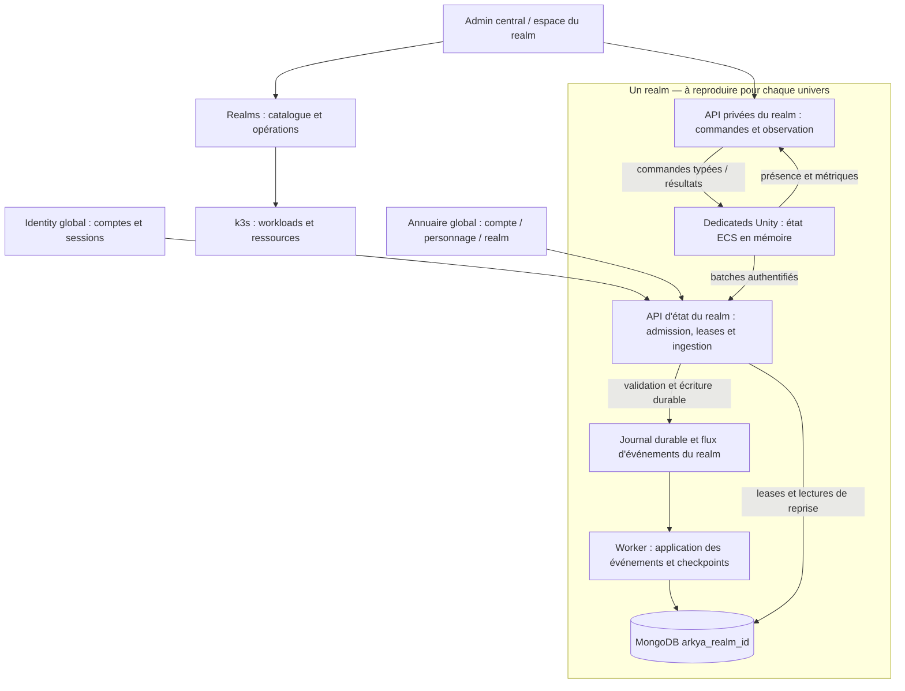

# Architecture et infrastructure des realms

Revue du 24 octobre 2026. Les cinq exigences exprimées par l'utilisateur
définissent la cible : plusieurs Areas par realm, une grille X/Y avec un
dedicated par cellule, une base et des événements isolés par realm, un état
autoritaire en mémoire sauvegardé par batches, et des services pilotables et
observables depuis l'admin. Cette revue ne déploie ni ne migre ces services.

Les garanties de persistance et les contrats ci-dessous sont une proposition
de réalisation de cette cible. Les valeurs d'exploitation restent à mesurer.
Les guides [déploiement](REALM_DEPLOYMENT.md), [opérations](REALM_OPERATIONS.md)
et [multi-Area](MULTI_AREA_RUNTIME.md) décrivent les implémentations existantes.

La [première tranche de stockage et routage par realm](REALM_STORAGE.md) est
maintenant implémentée, avec activation explicite après migration hors ligne.
Le tableau d'écarts ci-dessous conserve le constat initial de cette revue ;
le guide de stockage décrit le nouveau comportement disponible.

## Organisation du monde

```text
Realm
  Area starter-island
    Cellule (0, 0) -> dedicated A
    Cellule (1, 0) -> dedicated B
    Cellule (0, 1) -> dedicated C
    Cellule (1, 1) -> dedicated D
  Area mainland
    Grille indépendante -> un dedicated par cellule
  Services du realm + journal d'événements + worker de persistance
  MongoDB arkya_realm_<realmId>
```

L'Area est une carte entière. X/Y désigne sa grille dans l'admin ; les axes
horizontaux correspondants dans Unity sont X/Z, Y Unity restant l'altitude.
Une cellule est une partition d'autorité : un seul processus actif en possède
la simulation. Plusieurs cellules peuvent partager une machine physique, avec
des ressources attribuées à chaque processus. Ajouter des répliques derrière
un même Service ne crée pas de nouvelles partitions.

L'identité logique est `(realmId, areaId, cellX, cellY)`, complétée par
`instanceId` pour les futures copies indépendantes d'une carte. `serverId`
identifie le dedicated prévu dans le plan ; une identité de processus distincte
change à chaque démarrage. Une époque d'autorité et une lease empêchent un
ancien processus de continuer à écrire après sa relève. L'identité de copie
ne doit pas être confondue avec le champ historique `instanceId` des commandes,
qui désigne actuellement le processus lancé.

Deux niveaux sont distincts : le bail de cellule/processus est une garantie
cible à ajouter ; les baux par personnage existent déjà dans Characters et
restent nécessaires à l'admission et au handoff. Une réplique Kubernetes ne
constitue pas à elle seule un mécanisme de fencing de cellule.

Les bornes et voisins proviennent du plan enregistré par Realms. Une frontière
interne appartient à une seule cellule. Le transfert entre cellules conserve
le personnage et son realm ; les portails relient des Areas distinctes.
Redécouper une carte en exploitation exige un drain et une migration d'autorité.

## Services globaux et services du realm



Les boîtes représentent des responsabilités cibles. Elles n'imposent pas un
microservice par boîte : l'API d'état et son worker peuvent être deux hôtes
du même service Characters adapté au realm. Le journal peut commencer dans
MongoDB, dans cette même base ; un broker supplémentaire n'est pas choisi ici.
Le transport de jeu Netcode reste direct entre client et dedicated, séparé de
ces appels de contrôle et de persistance.

| Périmètre | Propriété cible |
| --- | --- |
| Global | Identity et sessions ; catalogue Realms et opérations de déploiement ; sessions Admin ; catalogues de contenu publiés. |
| Annuaire global Characters | Références compte → personnages → realm, routage et réservations de noms nécessaires aux règles existantes. Aucun inventaire ni snapshot de gameplay. |
| Chaque realm | Personnages et progression du realm, possessions, état persistant du monde, admissions, leases, transferts, journal et checkpoints. |
| Chaque dedicated | Simulation autoritaire en mémoire de sa cellule ; file bornée des mutations à transmettre. Aucun accès MongoDB direct. |
| API d'état et worker | Propriétaire applicatif unique de l'état persistant du realm ; validation des écritures, déduplication, reprise et vues de lecture. |

Chaque realm dispose de sa **propre base MongoDB** et d'identifiants d'accès
limités à cette base. Plusieurs bases peuvent partager un replica set ; une
base distincte ne réserve ni CPU ni disque et ne fournit pas une haute
disponibilité à elle seule. L'isolation physique reste un choix de capacité.
Les bases globales existantes, dont `arkya_identity`, `arkya_admin`,
`arkya_content` et `arkya_realms`, conservent leurs responsabilités globales.

Les collections restent possédées par un service précis. Le worker est un
adaptateur interne de ce propriétaire ; les autres services passent par ses
contrats et ne modifient pas ses collections. Le routage vers un realm est
résolu côté serveur depuis le personnage et l'identité dédiée authentifiée,
jamais depuis un nom de base ou une URL fournis par le joueur.

Chaque realm possède aussi son espace logique d'événements, ses permissions,
ses positions de consommation et ses limites. Une infrastructure de transport
peut être mutualisée, mais un dedicated ne publie ou ne consomme que dans son
realm. La synchronisation ne réplique pas tout l'état de tous les dedicateds :
elle transmet les événements métier et les observations nécessaires. Le combat
frontalier reste validé par le propriétaire de la cible, avec déduplication.

## État mémoire, batches et sauvegarde

1. Le dedicated acquiert son autorité en état `Recovering`, avec exclusion de
   l'ancien propriétaire, et fixe une borne durable de reprise. Il charge le
   checkpoint et les événements jusqu'à cette borne avant de passer `Ready`.
   L'admission d'un personnage exige aussi sa propre lease valide.
2. Il regroupe les mutations persistantes pendant un intervalle configurable
   `PersistenceFlushIntervalSeconds`. Une limite de taille déclenche aussi un
   envoi ; le réseau et les IO ne bloquent pas le tick ECS.
3. L'API vérifie l'identité du realm/dedicated, la lease, l'époque et les
   séquences. Elle accuse réception après enregistrement durable du journal.
4. Le worker applique les événements aux documents et crée périodiquement un
   checkpoint. Il persiste atomiquement les effets et sa progression de lecture.
5. Les événements métier destinés à d'autres consommateurs sont publiés depuis
   une outbox persistée avec leurs effets ; chaque consommateur déduplique.

Un batch contient des enveloppes versionnées : `eventId`, `realmId`, `serverId`,
identité de processus, `authorityEpoch`, `aggregateId`, `sequence`, `schemaVersion`,
`eventType` et payload borné. L'ordre requis est celui d'un agrégat, par exemple
un personnage, pas un ordre total entre toutes les cellules. Le changement
d'époque ne remet pas sa séquence à zéro. Un événement déjà accepté avec le
même identifiant et le même contenu retourne le même résultat ; un contenu
différent est un conflit. Un trou de séquence bloque cet agrégat et déclenche
une reprise, sans ignorer silencieusement des mutations.

Le contrôle de lease et l'acceptation durable doivent être atomiques vis-à-vis
du transfert d'autorité : une validation suivie d'une insertion indépendante
laisserait passer une ancienne autorité. Le stockage doit fournir cette
garantie par transaction ou par écriture atomique adaptée. Une transaction
MongoDB multidocument implique une infrastructure compatible, à provisionner.
Un batch ne reçoit un succès global que si toutes ses entrées sont durables ;
un résultat partiel identifie explicitement les entrées acceptées.

L'accusé distingue `durablyAccepted` (journal récupérable) et `applied`
(documents mis à jour). Un événement accepté avant un handoff reste applicable
après celui-ci : le worker respecte l'autorité validée à l'ingestion et la
barrière de transfert. Il ne le rejette pas simplement parce que la lease a
changé entre-temps. Un nouvel événement d'une ancienne époque reste refusé.

Pour MongoDB répliqué, la cible utilise des écritures avec acquittement
`majority`, journalisation et délai borné ; le comportement d'un timeout doit
être résolu par une répétition idempotente. Ces garanties dépendent de la
[configuration de write concern MongoDB](https://www.mongodb.com/docs/manual/reference/write-concern/).
La publication avec outbox associe effets et événement dans la même transaction,
puis les relaie avec retries ; voir le [principe d'outbox transactionnelle](https://learn.microsoft.com/en-us/azure/architecture/databases/guide/transactional-out-box-cosmos).
Ce choix ne demande pas de remplacer MongoDB par les produits Azure de cet exemple.

### Pannes et opérations sensibles

| Situation | Garantie cible |
| --- | --- |
| Crash avant envoi du batch | Les changements uniquement en RAM peuvent être perdus. L'intervalle X seul ne borne pas cette perte si les envois sont retardés. |
| Crash après acquittement durable | Reprise depuis checkpoint + journal, même si le worker n'avait pas encore appliqué les événements. |
| Réponse perdue ou événement livré deux fois | Même identifiant et même séquence ; une seule application des effets. |
| Worker ou stockage indisponible | File bornée, retries espacés, mesure de l'ancienneté ; au seuil prévu, refus des mutations persistantes puis drain selon la politique définie. |
| Événement invalide | Mise à l'écart avec diagnostic ; l'agrégat concerné reste bloqué jusqu'à résolution. |
| Arrêt demandé | Fermer les admissions, drainer, envoyer le dernier batch, attendre la durabilité requise, puis libérer l'autorité. |
| Achat, échange ou récompense économique | Confirmation au joueur seulement après commit durable des effets métier ; pas d'attente du prochain batch périodique pour déclarer le succès. |

L'intervalle d'envoi, la fréquence des checkpoints et l'objectif de perte
acceptable sont trois réglages distincts. Une file locale persistante peut
améliorer la reprise d'un processus, mais un disque de pod éphémère ne protège
pas d'une perte de nœud. La rétention du journal couvre au moins la reprise
depuis les checkpoints conservés et les fenêtres de déduplication.
Un échange entre deux personnages exige un commit atomique des deux effets
ou un protocole métier durable de réservation et de reprise ; deux événements
indépendants ne suffisent pas à prévenir perte ou duplication. Un `transactionId`
stable relie tous les participants et permet de reprendre le résultat global.

### Transfert entre dedicateds

Le passage conserve la garantie actuelle de propriétaire unique : préparer la
cible, arrêter les nouvelles mutations source, rendre durable le dernier état
et sa séquence, puis commuter atomiquement propriétaire, lease et époque avec
une référence vers cet état récupérable. La cible reprend après cette barrière
avant d'être activée. Un timeout après commit se résout par lecture du résultat
durable ; il ne réactive pas aveuglément l'ancienne autorité. Si la barrière
ne peut être persistée, le transfert n'est pas déclaré réussi.

## Administration et observation

Chaque service publie un contrat privé de santé, version, capacités et
opérations. L'admin appelle les API propriétaires ; les dedicateds peuvent
continuer à relever leurs commandes auprès de Realms. Cela satisfait le
pilotage depuis l'admin sans exposer une console réseau publique par processus.
Realms reste seul propriétaire des workloads, du déploiement et des opérations
Kubernetes. Le rôle Ops route les commandes métier vers leur service propriétaire ;
il ne crée pas un second registre concurrent. Une commande garde un unique
enregistrement durable et le même `commandId` jusqu'au résultat. Pour les
commandes dedicated existantes, ce registre reste celui de Realms.

Les cibles de commande sont explicites : realm, Area, cellule/dedicated ou
personnage. Une commande de realm se développe en sous-commandes suivies
individuellement. L'enveloppe comporte `commandId`, cible, type, paramètres,
révision/époque attendue si nécessaire, acteur, motif et expiration. Les droits
et capacités sont vérifiés côté serveur. Les résultats distinguent attente,
exécution confirmée, échec, expiration et résultat inconnu ; une réponse perdue
ne justifie pas de répéter une mutation sans preuve d'idempotence.

| Objet | Lectures et opérations cibles |
| --- | --- |
| Realm | Santé agrégée, joueurs, Areas, dépendances, retard de persistance ; annonce, fermeture des admissions, drain, sauvegarde, redémarrage et mise à jour suivis. |
| Dedicated | Identité, cellule, version, heartbeat, population, ressources, tick, files ; annonce, kick, sauvegarde, drain et redémarrage de la cible autorisée. |
| Persistance / événements | Disponibilité, dernier batch durable/appliqué, retard, erreurs et événements bloqués ; checkpoint et reprise contrôlée avec audit. |
| Joueur | Présence courante et dedicated propriétaire ; dernière sauvegarde séparée ; actions routées vers le propriétaire et refusées si son époque a changé. |

La fiche d'un joueur affiche `realmId`, `areaId`, cellule, `serverId`, identité
du processus et époque, statut de présence, dernier contact et expiration de
lease. Un transfert affiche source et cible, sans compter deux propriétaires.
Une information périmée devient inconnue ou expirée ; un dernier snapshot
sauvegardé n'est pas une preuve de connexion courante. La présence doit aussi
être visible avant la première sauvegarde du personnage.

La fiche dedicated et la grille de l'Area affichent au minimum :

- joueurs/connexions et capacité configurée ;
- CPU utilisé avec unités et limite allouée, mémoire utilisée/limite ;
- durée de tick et percentiles sur une fenêtre annoncée, dépassements du budget ;
- débit réseau et indicateurs de latence disponibles ;
- nombre, octets et âge du plus ancien événement non durable ; retard du worker ;
- dernier heartbeat, version réellement annoncée, état Ready/Draining/Offline.

Chaque mesure porte sa source, son horodatage et sa durée de validité. Les
ressources viennent de l'infrastructure, les ticks et files du runtime. Aucune
valeur inconnue n'est remplacée par zéro. Un indicateur synthétique de charge
doit publier sa formule ; le nombre de joueurs seul ne mesure pas la charge.
Les métriques agrégées évitent les labels par personnage ; la recherche d'un
joueur utilise la présence paginée. Les secrets restent côté services.

## Écart avec le dépôt au 24 octobre 2026

| Besoin | État constaté | Travail restant |
| --- | --- | --- |
| Realm → Areas → grille → dedicated | Déjà décrit et implémenté dans le générateur de topologie ; une réplique par partition. | Conserver cette propriété dans l'exploitation et les transferts. |
| Base propre à chaque realm | `Arkya.Characters.Api` utilise une base commune `arkya_characters`, avec filtrage logique par realm. Realms possède son catalogue global dans `arkya_realms`. | Stockage gameplay par realm, identités d'accès limitées et annuaire/routage global. |
| État en RAM et sauvegarde regroupée | Le runtime admis sauvegarde des snapshots HTTP par personnage toutes les 15 s, renouvelle sa lease toutes les 20 s ; lease de 90 s par défaut. | Ingestion de batches, journal durable, worker, checkpoints et reprise. Aucun bus durable de realm n'est revendiqué. |
| Services et commandes admin | Déploiement/redémarrage/mise à jour/suppression du realm, taux, `announce`, `kick`, `save` par dedicated et résultats existent. | Capacités des nouveaux services, agrégation de commandes, drain et maintenance par dedicated. |
| Localiser un joueur | Présence dérivée de la lease ; fiche détaillée avec serveur quand un état sauvegardé existe. | Projeter le propriétaire courant indépendamment du snapshot, avec Area/cellule et fraîcheur. |
| Voir la charge | Réplicas, état Kubernetes, versions/dernier contact et population par realm sont consultables. | CPU/RAM, temps de tick, trafic et retard de persistance par dedicated dans l'admin. |

Sources de la revue :
[générateur de topologie](../backend/src/Arkya.Realms.Api/Application/RealmTopologyBuilder.cs),
[configuration Characters](../backend/src/Arkya.Characters.Api/appsettings.json),
[stockage des leases](../backend/src/Arkya.Characters.Api/Infrastructure/Persistence/MongoGameLeaseStore.cs),
[sauvegarde et admission](../backend/src/Arkya.Characters.Api/Application/GameAdmissionService.cs),
[contrats de présence](../backend/src/Arkya.ServiceDefaults/CharacterAdminContracts.cs),
[projection de la fiche personnage](../backend/src/Arkya.Characters.Api/Application/CharacterAdminDetailService.cs),
[contrats Admin](ADMIN_CONSOLE.md) et
[garanties du handoff](STARTER_ISLAND_HANDOFF.md). Cette revue porte sur les
sources et les contrats, sans nouvelle validation en jeu ni audit du cluster actif.
Les quêtes historiques restent un flux de sauvegarde distinct, sans lease dans
leur contrat ; leur migration doit rejoindre les mêmes contrôles avant de
revendiquer une persistance unifiée. Voir les [limites actuelles des quêtes](QUEST_CONTENT.md).

## Ordre de réalisation

1. Introduire le routage et le stockage par realm. Migrer personnages, quêtes,
   possessions, leases et admissions avec contrôle des comptages, IDs et
   révisions. Drainer les écritures avant bascule, éviter deux writers et
   prévoir le retour arrière. Les personnages historiques sans realm demandent
   une règle explicite ; les IDs et l'unicité actuelle des noms sont conservés.
   La création annuaire/realm doit avoir un état durable et une reprise
   idempotente, sans supposer une transaction entre services.
2. Introduire le journal durable et l'ingestion, puis le worker, avec parité
   des snapshots et maintien de l'atomicité lease/état/transfert. Une écriture
   async ne doit pas contourner les contrôles existants.
3. Exposer présence courante, métriques et capacités depuis les propriétaires,
   puis les afficher dans les listes, fiches et cartes de l'admin.
4. Ajouter drain, sauvegarde avec barrière et opérations ciblées, avec résultats
   par serveur et comportement défini sur échec partiel.

Avant de déclarer cette cible réalisée : vérifier deux realms isolés, y compris
avec les mêmes coordonnées et IDs locaux, et au moins deux dedicateds source/cible
avec un client pour les transferts ; crash avant/après ACK durable ; worker arrêté ; doublons
et trous de séquence ; transfert concurrent à une sauvegarde ; refus de l'ancien
propriétaire ; restauration checkpoint + journal ; métriques périmées ; commande
dont le résultat est perdu. L'intervalle X, les budgets CPU/tick, la rétention,
les seuils de drain, la capacité par cellule et le choix éventuel d'un broker
restent des paramètres à fixer par mesure, pas des garanties déjà livrées.
